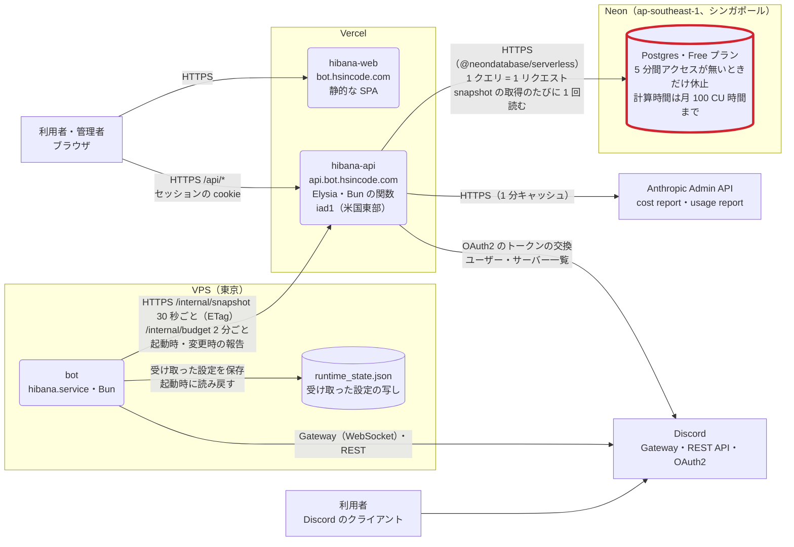
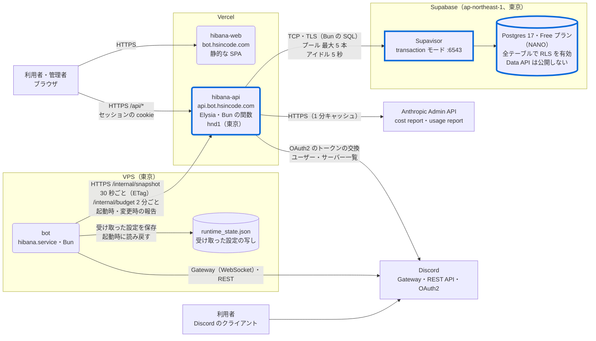

# 構成図

本番環境の構成の変更を、前と後を比べる図にしたもの。図は Mermaid で書き、このファイルの Git の履歴で更新を追う。各図には、目的・記法・書いていないもの・対象の版を添える。

今の本番の構成図は [README](../README.md#本番の構成) にある。このファイルの図は、それぞれ書いた版の構成を表すので、後で構成が変わっても書き換えない（今の構成は README の図を直す）。

## 設定 API の DB の移行（2026-10-21、Neon → Supabase）

設定 API（`apps/api`）の DB を、Neon から Supabase（東京）に移し、API の関数を東京（Vercel の `hnd1`）に置いた変更の、前と後の構成（#92・#93・#94、[ADR-0012](adr/0012-move-api-database-to-supabase.md)、[database.md](database.md)）。

### 図にした理由

この移行で変わったのは DB の事業者だけではない。API の関数の場所、DB への接続の方式（HTTP から TCP と接続プールへ）、公開鍵からの読み取りの防ぎ方（RLS・Data API）、止まる条件が同時に変わった。文章だけでは、次の点が追いにくい（#107）。

- どの通信が、どの頻度で、どのリージョンの間を往復しているか
- 移行前の構成で、どこが枠を使い切って止まったか
- 移行で何が変わり、何が変わっていないか

そこで、前と後を同じ記法のシステム構成図で並べる。

### 記法

2 枚の図で共通。

| 表し方                 | 意味                                               |
| ---------------------- | -------------------------------------------------- |
| 角の丸い四角           | Hibana のプロセス（bot・Web・API）                 |
| 円柱                   | データの保存先                                     |
| 四角                   | 外部のサービス、利用者                             |
| 外側の枠               | 事業者とリージョン                                 |
| 矢印                   | 接続を始める側から、受ける側へ。ラベルは経路・頻度 |
| 赤い太枠（移行前の図） | 2026-10-17 ごろに枠を使い切って止まった要素        |
| 青い太枠（移行後の図） | 移行で変わった要素                                 |

### 移行前（`793fbe8`、2026-10-18〜10-21）

止まり方（#92）:

- bot は 30 秒ごとに `/internal/snapshot` を呼び、API はそのたびに DB を 1 回読む（変わっていなくて 304 を返すときも読む）。Neon の Free は、5 分間アクセスが無いときだけ休止する。このため休止できず、2026-10-17 ごろに月 100 CU 時間の枠を使い切った、と見ている（仮説 A。Neon の Usage 画面での確認は残っている）
- 枠を使い切った後は、Neon が HTTP 402 を返し、API は起動に失敗して、すべてのリクエストに 500 を返した。ダッシュボードは使えなくなった
- bot は、最後に受け取った設定で動き続けた。問い合わせの失敗が続いたので、間隔は 5 分（バックオフの上限）まで延びた
- 通信の往復: bot（東京）→ API（米国東部）→ DB（シンガポール）と、1 回の設定の取得で太平洋を 2 回渡っていた（#27 で指摘）

### 移行後（`a796753`、2026-10-21〜）

変わった点:

| 項目                     | 移行前                                                      | 移行後                                                                                                              | 理由・根拠                                                                                                                             |
| ------------------------ | ----------------------------------------------------------- | ------------------------------------------------------------------------------------------------------------------- | -------------------------------------------------------------------------------------------------------------------------------------- |
| DB                       | Neon の Free（ap-southeast-1）                              | Supabase の Free（ap-northeast-1、NANO）                                                                            | 常時起動で計算時間の枠が無いので、30 秒ごとの読み取りで枠を使い切らない。費用は $0 のまま（#93）                                       |
| API の関数               | `iad1`（既定）                                              | `hnd1`（`apps/api/vercel.json` の `regions`）                                                                       | DB と bot が東京にあり、API は 1 リクエストで DB を何回も順に呼ぶ（ADR-0012）                                                          |
| ドライバと経路           | `@neondatabase/serverless`（HTTP。1 クエリ = 1 リクエスト） | Bun に組み込みの `SQL`（TCP・TLS）。Supavisor の transaction モード（:6543）を通す                                  | 普通の TCP 接続なので、どの Postgres にもつながる（database.md）                                                                       |
| 接続の持ち方             | クエリごとの HTTP リクエスト                                | API のインスタンスごとのプール（最大 5 本、アイドル 5 秒）。`prepare: false`                                        | Vercel は Fluid compute のプールにアイドルの短いタイムアウトを勧めている。transaction モードは名前つきの prepared statement を使えない |
| 接続が閉じられていたとき | —                                                           | 閉じた接続のエラー 2 種類（57P01、`ERR_POSTGRES_CONNECTION_CLOSED`）のときだけ、プールを作り直して最大 3 回まで実行 | Vercel がアイドルのインスタンスを休止させている間に、サーバー側が接続を閉じる（database.md）                                           |
| 公開鍵からの読み取り     | —                                                           | Data API で `public` を公開しない。API が作るテーブルすべてで RLS を有効にし、ポリシーは作らない                    | Supabase の Data API は、`public` のテーブルを公開鍵で REST から読めるようにする（#93）                                                |
| 止まる条件               | 月 100 CU 時間の超過                                        | 容量 500 MB、転送量 月 5 GB、7 日間ほとんど使われないときの一時停止                                                 | 見直す条件は ADR-0012                                                                                                                  |

変わっていないもの: bot と API の間の通信（経路・頻度・認証）、Web、Discord と Admin API への通信、bot の設定の写し、テーブルの定義（12 テーブル。`logs` は会話ログを有効にしたときだけ作る）。

移行の操作（図には書いていない）: Neon は 402 で読み出せなかったので、手元の PC から SSH で bot の `runtime_state.json` を読み、`scripts/import-bot-snapshot.ts` で Supabase に復元した。snapshot は手元のディスクに保存していない。戻るもの・戻らないものは [database.md](database.md#復元されるものされないもの)。

### 書いていないもの

- DNS と TLS の終端（Cloudflare。`bot.hsincode.com` は Cloudflare を通し、`api.bot.hsincode.com` は DNS だけで Vercel の証明書を使う）。[production.md](production.md)
- relay と CI/CD（[relay.md](relay.md)、ADR-0001〜0007）
- bot の sandbox（Docker）、Caddy と公開サイト、自宅回線の中継
- LLM のプロバイダー（Anthropic・OpenAI など）への通信
- bot の会話の保存先（`conversations.db`、SQLite。[ADR-0008](adr/0008-keep-conversations-across-restarts.md)）
- Supavisor の先の Postgres の内部構成、Neon と Supabase の物理的な配置
- 移行前と移行後で変わらない、API の各エンドポイントの中身

### 対象の版と、確かめた方法

- 移行前: `793fbe8`（#94 のマージの直前の main）。`apps/api/vercel.json` に `regions` が無く、関数は既定の `iad1`。`apps/api/src/store.ts` は `@neondatabase/serverless` を使う。Neon のリージョンは、2026-09-19 時点の環境変数の接続先（#27）
- 移行後: `a796753`（#94 のマージ）。関数が `hnd1` で動くことは、応答の `x-vercel-id`（`kix1::hnd1::…`）で、Supabase のリージョン・プラン・RLS・Data API の状態は、#94 のコメントの記録で確かめた
- bot と API の間の頻度は、`apps/bot/src/sync.ts` の `SNAPSHOT_POLL_MS`（30 秒）と `BUDGET_POLL_MS`（2 分）
- 移行後の図から青い太枠を除いたものが、[README の構成図](../README.md#本番の構成)の最初の版
