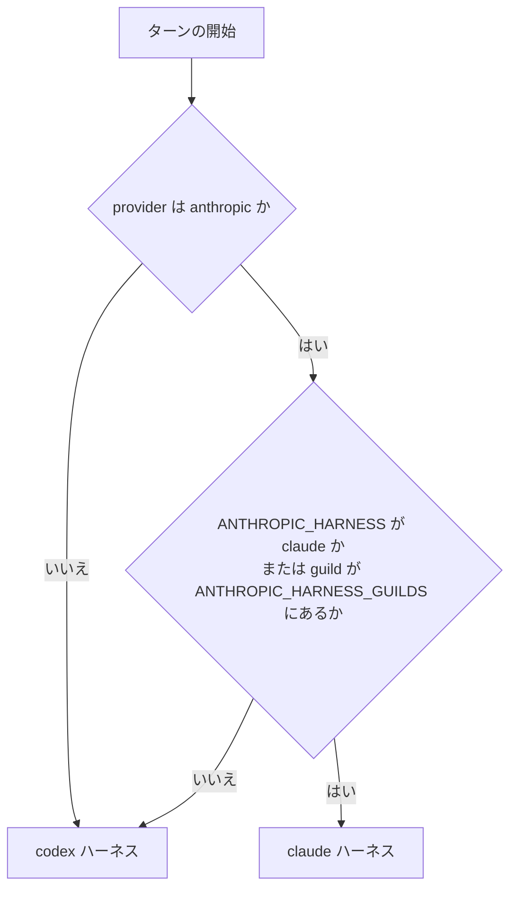

# ハーネス

bot のハーネスは、システムプロンプト、モデルに見せるツール、ツールを回すループ、会話の表現をまとめたものです。この文書は、ハーネスをプロバイダーで分ける作り直しの現在地を書きます。

**状態（2026-10-11）: 移行中。新しいハーネスはまだ実装されていません。** `main` で動いているのは、全プロバイダー共通の 1 つのハーネス（Codex CLI を参考にしたもの）です。

- 判断記録: #66（構成・対象・出し方）、#67（Anthropic 以外の非推奨化）、#68（Anthropic のサブエージェント）
- 計測記録: #69（作り直しの前後の比較）
- ADR: [ADR-0009](adr/0009-split-the-harness-by-provider.md)、[ADR-0010](adr/0010-deprecate-non-anthropic-providers.md)（どちらも「提案」）

## 2 つのハーネス（計画）

| | `codex` | `claude` |
|---|---|---|
| 対象 | `anthropic` 以外のプロバイダー。切り替えるまでは `anthropic` も | `provider === "anthropic"`（公式 API）だけ |
| 状態 | 現行。凍結する（#67） | 未実装 |
| システムプロンプト | `apps/bot/prompts/harness/codex.md` と `apps/bot/prompt.md` | 公開ドキュメントを出所に自作する |
| ツール | `shell_command`、`apply_patch`、`update_plan` と、`mcp__` 名の統合ツール | Claude Code と同じ名前と入力の形（`Bash`、`Read`、`Edit` など）。統合ツールは遅延読み込み |
| 会話の表現 | Chat Completions 形（`apps/bot/src/types.ts`） | 送受信した内容をそのまま持つ、追記専用の形 |

## 選び方（計画）

出し方は #66 で本人が決めます。下の図は AI の提案（環境変数と guild の許可リスト）を、手で描いたものです。

## プロンプトの出所（規則）

`claude` ハーネスのシステムプロンプトとツールの説明は、Claude Code の文面を写しません。公開されているドキュメントを出所として自作し、節ごとに、参照した URL・取得日・「自作 / 文書の例文を改変」の別をこの文書に表で残します。表は、プロンプトを追加する PR で足します。

参照する予定の公開ドキュメント:

- プロンプトの書き方: <https://platform.claude.com/docs/en/build-with-claude/prompt-engineering/claude-prompting-best-practices>
- Claude Code のツールと挙動: <https://code.claude.com/docs/en/tools-reference>
- ループと context の扱い: <https://code.claude.com/docs/en/agent-sdk/agent-loop>
