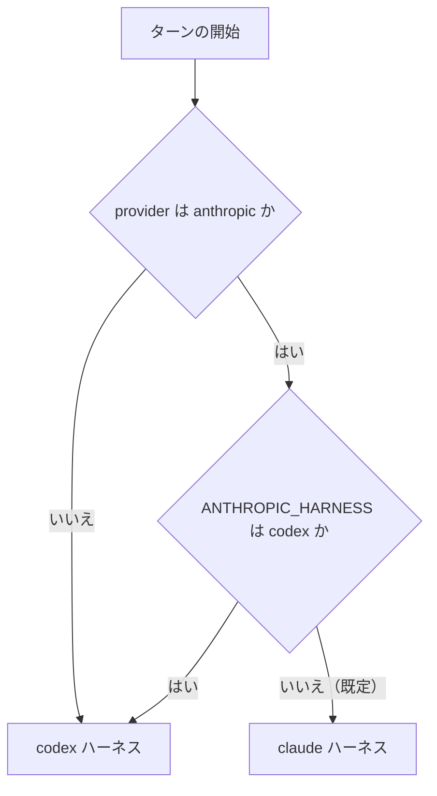

# ハーネス

bot のハーネスは、システムプロンプト、モデルに見せるツール、ツールを回すループ、会話の持ち方をまとめたものです。ハーネスは 2 つあり、ターンのプロバイダーで決まります。

- 判断記録: #66（構成・対象・出し方）、#67（Anthropic 以外の非推奨化）、#68（Anthropic のサブエージェント）
- 計測記録: #69（作り直しの前後の比較。**まだ計測していません**）
- ADR: [ADR-0009](adr/0009-split-the-harness-by-provider.md)、[ADR-0010](adr/0010-deprecate-non-anthropic-providers.md)

## どちらで動くか



（手で描いた図です。判定は `apps/bot/src/claude/select.ts` の `harnessFor`。）

| | `codex` | `claude` |
|---|---|---|
| 対象 | `anthropic` 以外の全プロバイダー（`claude_max`・`claude_kiro` を含む） | `provider` が `anthropic`（公式 API）のターン |
| 位置づけ | 非推奨の側。今のまま変えない（#67） | Claude Code の設計に寄せた新しい側（#66） |
| システムプロンプト | `apps/bot/prompts/harness/codex.md` と `apps/bot/prompt.md` | `apps/bot/prompts/harness/claude.md` と `apps/bot/prompt.claude.md` |
| ツール | `shell_command`・`apply_patch`・`update_plan` と、`mcp__` 名の統合ツール全件 | `Bash`・`Read`・`Edit`・`Write`・`Glob`・`Grep`・`AskUserQuestion`・`Skill`・`Agent` と、`mcp__` 名の統合ツール（必要なときに読み込む） |
| 会話の縮め方 | 古いターンを落とす。スレッドは古い側を要約する | 会話全体を API に要約させて置き換える |
| サブエージェント | off / on / ultra / multi（`docs/multi-agent.md`、`docs/ultracode.md`）。`anthropic` をこのハーネスに戻したときは off（#35） | `Agent` ツール（off / on だけ。保存値の ultra / multi は on として動く） |

`codex` 側のファイルと、そこから送るリクエストは、`apps/bot/src/__tests__/harness-freeze.test.ts` が固定しています。

### 切り替えと切り戻し

- bot の環境変数 `ANTHROPIC_HARNESS=codex` で、`anthropic` のターンも `codex` ハーネスで動きます。VPS の `bot.env` を変えて `systemctl restart hibana` するだけで、API・Web・DB は触りません
- 会話とチェックポイントは、ハーネスごとに別のキーで保存します。切り替えると、`anthropic` を使っているチャンネルの会話は 1 回最初からになります（Auto Routing の経路も選び直しになり、通知が出ます）。`codex` 側のキーは、`claude` ハーネスを入れる前と同じ文字列です
- 別のハーネスで保存されたチェックポイントは再開しません（`/retry` は「再開できる作業はありません」と答えます）

## claude ハーネス

Claude Code から再現しているのは設計です。文面は写していません（下の「出所」）。

### プロンプト

- **システムプロンプト**は 2 つのファイルをつないだものだけです。サーバー・利用者・モデルによらず同じ文字列なので、キャッシュが効き、会話の途中で変わりません
- **`<hibana_context>`**（人格、サーバーや個人の指示、作業領域の範囲、スキルの一覧）は、会話の中の user メッセージとして送ります。会話にまだ無いときと、内容が変わったときだけ、新しいメッセージとして足します
- 利用者のメッセージの末尾に `[date: YYYY-MM-DD]` を足します（UTC）

### ツール

| ツール | 中身 | Claude Code との違い |
|---|---|---|
| `Bash` | 既存のサンドボックス（呼び出しごとに新しいコンテナ、512 MiB、1 CPU） | タイムアウトは既定 120 秒・最長 360 秒。バックグラウンド実行は無い。30,000 字を超える出力は `/workspace/.hibana/tool-output/` に保存し、先頭と末尾を返す |
| `Read` | 行番号つきで返す。1 回 2,000 行・60,000 字まで | PDF とノートブックは読まない（シェルで変換する）。画像は 8 MiB まで |
| `Edit` | 完全一致の置換。1 か所だけ、または `replace_all` | 事前の `Read` は要求しない。UTF-8 でないファイルは断る |
| `Write` | 作成と上書き | — |
| `Glob` | 更新の新しい順に 200 件まで | 50,000 ファイルで探索を打ち切り、その旨を返す |
| `Grep` | コンテナ内の ripgrep。20 秒まで | — |
| `AskUserQuestion` | Discord のボタンで質問する | 1〜3 問、選択肢は 2〜3 個。複数選択は無い。5 分で打ち切り |
| `Skill` | スキルの本文とファイル一覧を返す | — |
| `Agent` | 下の「サブエージェント」 | — |
| 統合ツール | Discord・設定・サイト・メディアなど。`mcp__<group>__<name>` | 配信と読み取りの 4 つ以外は、Anthropic の tool search で必要なときに読み込む |

- 出していないもの: TodoWrite / Task 系、NotebookEdit、LSP、Monitor、Cron、Plan mode、Worktree、Workflow
- **一覧は会話の全員で同じです。** 話す人によって一覧が変わると、リクエストの先頭が変わるためです。その人が呼べるかどうかは、呼び出しのときに判定します
- Jev の行動選択モード（`run_jev_task`）は、このハーネスでは設定にかかわらず使いません。設定でツールの一覧を書き換える仕組みで、一覧を固定する方針と両立しないためです

### ループ

- ツールの結果は、ツールが書いた文字列のまま返します。失敗は `is_error`、画像は結果の中に入れます
- 同じ呼び出しは、**連続** 3 回目を断ります。間に別の呼び出しが入れば数え直します
- 読み取り系と `Agent` は同時に 6 件まで並行し、それ以外は 1 件ずつ実行します（`codex` 側と同じ決まり）
- 進捗表示は、モデルがツール呼び出しと一緒に書いた文、無ければ Opus 5.5 / Sonnet 5.5 が thinking ブロックに書いたメモ、それも無ければツール呼び出しから作った 1 行です

### 会話の持ち方

- 一度送った内容は変えません。Opus 5.5・Sonnet 5.5・Haiku 5.5 は、`system`・`tools`・過去のメッセージが変わると、それ以降の thinking ブロックを受け付けないためです
- 画像は、受け取ったときに取得して、データとして会話に保存します（Discord の URL は期限が切れるため）。1 枚 3.7 MB を超える画像と、png / jpeg / gif / webp 以外は渡しません
- 直前のリクエストが予算（既定 150,000 トークン。Haiku 5.5 は 80,000）を超えていたら、次のターンの前に、会話全体を API の要約（`compaction`）に置き換えます。API の要約が使えないときは、会話の中で要約を頼みます。どちらも失敗したら、要約せずにそのまま続けます
- thinking ブロックが拒否されたとき（デプロイでプロンプトやツール定義が変わった後に起きます）は、thinking ブロックを外して 1 回だけ送り直し、保存済みの会話からも外します

### Anthropic の機能への依存

| 機能 | 使う場面 | 拒否されたとき |
|---|---|---|
| tool search（`defer_loading`） | 統合ツールの遅延読み込み | 以後は全件を先に送る |
| `thinking.display: "updates"`（beta） | Opus 5.5 / Sonnet 5.5 の進捗表示 | 以後は要求しない。進捗表示はツール呼び出しから作る |
| on-demand compaction（beta） | 会話の要約 | 会話の中で要約を頼む |
| 会話途中の `role: "system"` | 途中で足す指示 | （現在、このハーネスは途中の指示を送っていません） |

`CLAUDE_TOOL_SEARCH=false` で、tool search を最初から使わないようにできます。

### サブエージェント

`Agent` ツールで、子に仕事を渡します。子は親の会話を見ず、最後の文章だけを親に返します。

| 種類 | モデル | できること |
|---|---|---|
| `Explore` | Haiku 5.5（medium） | 作業領域の読み取りと検索、メッセージの読み取り、web 検索。書き込みと実行はできない |
| `general-purpose` | そのターンと同じモデル | シェルとファイルの操作。配信・投稿・設定の変更・利用者への質問・子の起動はできない |

上限（環境変数で変えられます）: 1 ターンに 6 回、同時に 3 体（bot 全体で 6 体）、子 1 体は 32 往復まで。金額の上限はまだありません（#68）。

## 出所

`claude` ハーネスのシステムプロンプトとツールの説明は、公開文書に書かれた挙動をもとに、このリポジトリのために書いたものです。Claude Code のプロンプトやツール説明の文面は転記していません。書いたのは AI（Claude Code の上で動く Claude）で、持ち主による文面の確認はまだです。設計と数値の根拠にした公開文書は次のとおりです（取得日はすべて 2026-10-11）。

| 対象 | 参照した公開文書 | 文面 |
|---|---|---|
| `prompts/harness/claude.md` の全体の書き方（理由を添える、強い言い回しを使わない、ツール名を挙げない） | <https://platform.claude.com/docs/en/build-with-claude/prompt-engineering/claude-prompting-best-practices> | 自作 |
| 同「How a turn works」「Doing the work」（最後までやり切る、実行して確かめる、検索してから答える） | 同上の「Tool usage」「Minimizing hallucinations in agentic coding」と、Haiku 5.5 / Opus 5.5 のモデル別の節 | 自作。文書の例文と同じ趣旨の文を、自分の言葉で書いている |
| 同「並列のツール呼び出し」 | 同上の「Optimize parallel tool calling」 | 自作 |
| 同「Actions that affect others」 | 同上の「Balancing autonomy and safety」 | 自作 |
| 同「Delegating」、`claude-explore.md`、`claude-agent.md` | 同上の「Subagent orchestration」、<https://code.claude.com/docs/en/tools-reference>（Agent tool behavior） | 自作 |
| ツールの名前と入力の形（`Bash`・`Read`・`Edit` など） | <https://code.claude.com/docs/en/tools-reference>、<https://code.claude.com/docs/en/agent-sdk/agent-loop> | 名前と入力の項目名は Claude Code に合わせた。説明文は自作 |
| ツールの挙動の数値（タイムアウト、出力の上限、行数） | 同上（Bash tool behavior、Read tool behavior、Edit tool behavior） | 数値は Hibana のサンドボックスに合わせて決めた。上の「ツール」の表のとおり、Claude Code と違うところがある |
| 遅延読み込み | <https://platform.claude.com/docs/en/agents-and-tools/tool-use/tool-search-tool> | — |
| 会話の要約 | <https://platform.claude.com/docs/en/build-with-claude/compaction-on-demand> | 要約を頼む文（`claude/context.ts`）は自作 |

`codex` 側の `apps/bot/src/workflow/prompts.ts` は、ファイル冒頭のコメントのとおり Claude Code 2.1.282 の文面に沿っています。`claude` ハーネスは Workflow を出していないので、この文面は `claude` ハーネスからは送られません。この文面の扱いは #68 で決めます。

## 実 API での確認

`apps/bot/src/claude/smoke.ts`（`cd apps/bot && bun run claude-smoke`。`--opus` で Opus 5.5 も）は、本物のプロンプトとツール一覧で実際の Anthropic API にリクエストを送り、下の項目を 1 つずつ確かめる手動のスクリプトです。ツールは実行せず、結果はスクリプトが与えます。課金されるので `make ci` には入れていません。

2026-10-11 に、AI が手元から Haiku 5.5 だけで実行しました（接続先は `api.anthropic.com`。持ち主の承認は「Haiku と Jev であれば」。**持ち主による再実行はまだです**）。

| 項目 | 結果（Haiku 5.5） |
|---|---|
| 応答が返る | 成功 |
| 2 回目のリクエストが、1 回目の先頭をキャッシュから読む | 成功（入力 9,309 トークンのうち 9,305） |
| ツールの呼び出し、文字列の結果、その再送 | 成功 |
| 失敗した結果（`is_error`）を受け付け、続きを返す | 成功 |
| tool search で、先に読み込んでいないツールを見つけて呼ぶ | 成功（検索して `mcp__discord__pin_message` を呼んだ） |
| API の要約（compaction）が返る | 成功 |
| 要約から会話を続ける | 成功（ファイルを読み直さずに答えた） |
| 利用者が付けた画像（データとして送る） | 成功 |
| ツールの結果の中の画像 | 成功 |
| プロバイダーの web 検索ツールを、tool search・遅延読み込みと一緒に送る | 成功（リクエストが受け付けられた。検索は発生させていない） |

- 最後の実行は 15 リクエスト、入力 161,763 トークン（うちキャッシュ読み取り 156,526）、出力 1,274 トークン。`packages/shared` の単価表での推計は約 $0.0030 です（請求額は確かめていません）
- API が拒否した機能はありませんでした
- 画像の 2 項目は、最初の実行では失敗と出ました。返答が日本語（「赤」）だったのに、スクリプトの判定が英語の語だけを見ていたためです。判定を直して通しました。経過は #66 のコメントにあります

## 本番の質問を使った新旧の比較

計測記録は #69 です。指標は、持ち主が決めた「最終回答までの時間」「回答の品質」「コスト」。2026-10-11 に、本番でツールを使わなかった 6 件で時間と費用を計りました（AI が実行。持ち主による再実行と、品質の判定はまだです）。数値は #69 にあります。

```sh
# bot のデータがある機械で質問を取り出す（どちらも読み取りのみ。件数だけを表示する）
#   a. 保存されている会話から（今続いている会話だけ。件数は少ない）
(umask 077; ssh "$TARGET" 'PATH="$PATH:$HOME/.bun/bin" bun run -' < apps/bot/src/export-conversations.ts > .local/harness-eval/cases.jsonl)
#   b. ログにあるターンの本文を Discord から読み直す（ログの保存期間ぶん）
(umask 077; ssh "$TARGET" 'PATH="$PATH:$HOME/.bun/bin" bun run -' < apps/bot/src/export-discord-turns.ts > .local/harness-eval/candidates.jsonl.new \
  && mv .local/harness-eval/candidates.jsonl.new .local/harness-eval/candidates.jsonl)
cd apps/bot && bun run harness-eval pick --cases candidates.jsonl   # 候補から使う質問を選ぶページを手元に作る
cd apps/bot && bun run harness-eval run --cases candidates.jsonl --selection <selection.json>   # 新旧に 1 件ずつ流す（課金される）
cd apps/bot && bun run harness-eval review <run>        # 新旧を伏せた見比べ用のページを手元に作る
cd apps/bot && bun run harness-eval summary <run>       # 時間・費用・判定の集計
```

- 入力は、Anthropic の API か Claude のモデルを使ったターンです。出どころは 2 つあります。(a) bot が保存している会話（`conversations.db`）。今続いている会話だけなので件数は少なく（2026-10-11 の時点で 11 ターン）、同じ人の似た質問に偏りました。(b) bot のログにあるターン（保存は 14 日）の本文を、bot のトークンで Discord から読み直したもの。Discord には GET だけを送り、トークンはその機械の外に出しません。それまでの会話として付けるのは、同じチャンネルの直前のやり取り（同じプロバイダー・同じモデルで、30 分以内の間隔で続いているターン）です。再現に渡す文脈であって、本番の bot が覚えていた会話の記録ではありません（ログからは、会話がいつ消されたかが分からず、会話を保つ規則もログの 14 日の間に変わっています）。再現できないターン（失敗した、発言が消えた、`/retry` など）の直後 30 分以内のターン、見えなくなった発言への返信、ターンの途中で同じ人が発言を足したターンは除きます。発言の本文はそのまま保存します（本文に含まれるメンションやリンクも残ります）。API の `logs` 表は本番で有効にしていないので使えません
- (b) の候補は、持ち主が手元のページで選びます。似た質問は同じまとまりに並べます（2 文字ずつに切った文字の重なりが半分以上のもの）
- そのターンのモデルと effort は、bot のログ（本文は入っていません）の `Turn started`・`Auto route selected`・`Turn completed` を、質問の `message_id` で突き合わせて決めます。本番での所要時間もそこから取ります
- 質問と返答は人の発言なので、`.local/harness-eval/`（gitignore 済み）にだけ置き、Issue・PR・commit には件数と集計だけを書きます。チャンネルの ID は短いハッシュにして保存します
- 計るターンの直前に、同じハーネス・モデル・effort で短い質問を 1 回送り、どの会話にも共通の部分（システムプロンプトとツール定義）を Anthropic のキャッシュに載せます。どの件も温まった状態で計るためです（持ち主の判断）。キャッシュが空のときの費用は、この共通部分の大きさ × 書き込みの単価として別に出します
- 1 件を、従来のハーネスと新しいハーネスに 1 回ずつ流します。プロバイダーはどちらも `anthropic` です。それまでの会話は、質問と最終回答の文章だけを、どちらにも同じように渡します（途中のツール呼び出しとその結果は渡しません）。どちらを先に流すかは 1 件ごとに入れ替えます
- LLM、Docker のサンドボックス、Anthropic の web 検索は実物です。Discord・設定・サイトの公開など、それ以外のツールは、どちらのハーネスにも同じ「この再現では使えない」というエラーを返します。利用者への質問には「答える人がいない」と返します
- 再現できないターンは除き、理由ごとの件数を出します: 添付がある（それまでの発言にある場合も）、本文が無い、モデルが分からないか Anthropic の API に無い、ターンの途中で利用者が発言を足している、それまでのターンがツールを使っている（作ったファイルやツールの結果は、文章にした会話には入らないため）。`/image` の近道（モデルを通らない）は取り出しません
- 合格の基準（持ち主が 2026-10-11 に、結果を見る前に決めたもの）: 品質は「新がよい」＋「同じくらい」が「旧がよい」以上。費用と時間は、1 件ごとの新 ÷ 旧の中央値が 1.2 以下。失敗は新が旧より多くない
- 品質は、持ち主が、左右を伏せたページで「左がよい／同じくらい／右がよい／比較できない」を付けて判定します。どちらが新しいハーネスかは `key.json` にあり、集計のときにだけ使います
- 比較の限界: 温めるのは共通部分だけです。それまでの会話がある件では、その会話ぶんは計るリクエストで初めてキャッシュに書き込まれます（続けて話している本番のターンなら読み取りで済む部分で、新旧の両方に同じように乗ります）。Discord への投稿は、再現では待ち時間が 0 です（本番では進捗の投稿 1 回ごとに待ちが入り、ツールを使うターンで新しいハーネスのほうが回数が多くなります。回数は記録します）。時間は手元の機械での値です。サーバーごとの人格・指示・スキルは再現していません（既定のまま）。web 検索の課金（1 回 $0.01。料金ページを 2026-10-11 に確認）は、共有の単価表に行が無いので、比較の集計の中で足しています（web fetch に別の課金はありません）。本番の返答は、実際のツールと会話の続きで返したものなので、再現の 2 つとは条件が違います（参考として並べるだけです）

## 検証していない範囲

- **Opus 5.5 と Sonnet 5.5 で実 API に送ったのは、新旧の比較（#69）の会話だけのターンです**（Sonnet 5.5 が 5 回、Opus 5.5 が 3 回。温めのリクエストを含む。うち 1 回は web 検索つき）。リクエストは受け付けられ、`thinking.display: "updates"` と tool search は拒否されませんでした。自前のツールを呼ぶターン、複数ターンにわたる thinking ブロックの検査は、この 2 つのモデルでは確かめていません
- 実 API で確かめていない経路: サブエージェントの実行、実際のサンドボックスでのツール、入力長の超過と要約の自動の発動、thinking ブロックの復旧、Discord を通したターン全体、web 検索の実行
- 新旧の比較（#69）は、会話だけの 6 件・各 1 回です。ツールを多く使うターンは比べていません。品質は未判定です
- 本番での動作、サブエージェントの費用、要約にかかる費用と品質
