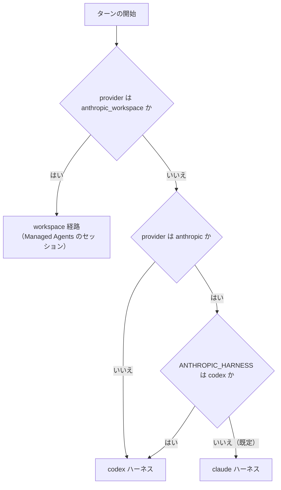

# ハーネス

bot のハーネスは、システムプロンプト、モデルに見せるツール、ツールを回すループ、会話の持ち方をまとめたものです。Hibana が自分でループを回すハーネスは 2 つあり、ターンのプロバイダーで決まります。

これとは別に、プロバイダー `anthropic_workspace`（表示名は Anthropic Workspace）のターンは、Claude Managed Agents のセッションで動きます。この文書では「workspace 経路」と呼びます。ループ・会話・作業領域は Anthropic 側にあり、Hibana が渡すのは、プロンプト、Discord と設定のツール、上限です。

- 判断記録: #66（構成・対象・出し方）、#67（Anthropic 以外の非推奨化）、#68（Anthropic のサブエージェント）、#76（Anthropic Workspace）
- 計測記録: #69（作り直しの前後の比較。**まだ計測していません**）
- ADR: [ADR-0009](adr/0009-split-the-harness-by-provider.md)、[ADR-0010](adr/0010-deprecate-non-anthropic-providers.md)、[ADR-0011](adr/0011-add-anthropic-workspace-provider.md)

## どちらで動くか



（手で描いた図です。判定は `apps/bot/src/claude/select.ts` の `harnessFor`。）

| | `codex` | `claude` | `workspace` |
|---|---|---|---|
| 対象 | `anthropic`・`anthropic_workspace` 以外の全プロバイダー（`claude_max`・`claude_kiro` を含む） | `provider` が `anthropic`（公式 API）のターン | `provider` が `anthropic_workspace` のターン |
| 位置づけ | 非推奨の側。今のまま変えない（#67） | Claude Code の設計に寄せた新しい側（#66） | 別のプロバイダーとして足した経路（#76）。ほかの 2 つの置き換えではない |
| ループを回すもの | Hibana（`Agent.run`） | Hibana（`Agent.run`） | Anthropic（Managed Agents のセッション） |
| システムプロンプト | `apps/bot/prompts/harness/codex.md` と `apps/bot/prompt.md` | `apps/bot/prompts/harness/claude.md` と `apps/bot/prompt.claude.md` | `apps/bot/prompts/harness/workspace.md`。Haiku Ultra のセッションは `workspace-ultra.md` を後ろに足す |
| ツール | `shell_command`・`apply_patch`・`update_plan` と、`mcp__` 名の統合ツール全件 | `Bash`・`Read`・`Edit`・`Write`・`Glob`・`Grep`・`AskUserQuestion`・`Skill`・`Agent` と、`mcp__` 名の統合ツール（必要なときに読み込む） | Managed Agents の組み込みの 8 個（`bash`・`read` など）と、Hibana のツール最大 76 個（custom tool。`mcp__` を付けない名前） |
| 作業領域 | bot の機械の Docker サンドボックス。サーバーの通常のチャンネルは 1 つを共有する | 同左 | Anthropic のクラウドのコンテナ。チャンネル・スレッド・DM ごとに別 |
| 会話の縮め方 | 古いターンを落とす。スレッドは古い側を要約する | 会話全体を API に要約させて置き換える | Anthropic 側が持つ。bot は会話を送り直さない |
| サブエージェント | off / on / ultra / multi（`docs/multi-agent.md`、`docs/ultracode.md`）。`anthropic` をこのハーネスに戻したときは off（#35） | `Agent` ツール（off / on だけ。保存値の ultra / multi は on として動く） | Hibana の委譲は無い。Haiku 5.5 で ultra のときだけ、Managed Agents の dynamic workflows（[Haiku Ultra](#haiku-ultra)） |

`codex` 側のファイルと、そこから送るリクエストは、`apps/bot/src/__tests__/harness-freeze.test.ts` が固定しています。workspace 経路を足すときに、このスナップショットの期待値は変えていません（対象を選ぶフィルターを `deprecatedProvider` に置き換えただけです）。Workspace の鍵を設定してプリセットを公開した状態でも、`codex` と `claude` のツール一覧・プロンプト・設定の解決結果が、鍵の無いときとバイト単位で同じになることは、`workspace-settings.test.ts` が確かめています。

### 切り替えと切り戻し

- bot の環境変数 `ANTHROPIC_HARNESS=codex` で、`anthropic` のターンも `codex` ハーネスで動きます。VPS の `bot.env` を変えて `systemctl restart hibana` するだけで、API・Web・DB は触りません
- 会話とチェックポイントは、ハーネスごとに別のキーで保存します。切り替えると、`anthropic` を使っているチャンネルの会話は 1 回最初からになります（Auto Routing の経路も選び直しになり、通知が出ます）。`codex` 側のキーは、`claude` ハーネスを入れる前と同じ文字列です
- 別のハーネスで保存されたチェックポイントは再開しません（`/retry` は「再開できる作業はありません」と答えます）
- `ANTHROPIC_HARNESS` は `anthropic_workspace` のターンには届きません。workspace 経路の止め方は、下の「[止め方と切り戻し](#止め方と切り戻し)」にあります

## claude ハーネス

Claude Code から再現しているのは設計です。文面は写していません（下の「出所」）。

### プロンプト

- **システムプロンプト**は 2 つのファイルをつないだものだけです。サーバー・利用者・モデルによらず同じ文字列なので、キャッシュが効き、会話の途中で変わりません
- **`<hibana_context>`**（人格、サーバーや個人の指示、作業領域の範囲、スキルの一覧）は、会話の中の user メッセージとして送ります。会話にまだ無いときと、内容が変わったときだけ、新しいメッセージとして足します
- 利用者のメッセージの末尾に `[date: YYYY-MM-DD]` を足します（UTC）

### ツール

| ツール | 中身 | Claude Code との違い |
|---|---|---|
| `Bash` | 既存のサンドボックス（呼び出しごとに新しいコンテナ、512 MiB、1 CPU） | タイムアウトは既定 120 秒・最長 360 秒。バックグラウンド実行は無い。30,000 字を超える出力は `/workspace/.hibana/tool-output/` に保存し、先頭と末尾を返す |
| `Read` | 行番号つきで返す。1 回 2,000 行・60,000 字まで | PDF とノートブックは読まない（シェルで変換する）。画像は 8 MiB まで |
| `Edit` | 完全一致の置換。1 か所だけ、または `replace_all` | 事前の `Read` は要求しない。UTF-8 でないファイルは断る |
| `Write` | 作成と上書き | — |
| `Glob` | 更新の新しい順に 200 件まで | 50,000 ファイルで探索を打ち切り、その旨を返す |
| `Grep` | コンテナ内の ripgrep。20 秒まで | — |
| `AskUserQuestion` | Discord のボタンで質問する | 1〜3 問、選択肢は 2〜3 個。複数選択は無い。5 分で打ち切り |
| `Skill` | スキルの本文とファイル一覧を返す | — |
| `Agent` | 下の「サブエージェント」 | — |
| 統合ツール | Discord・設定・サイト・メディアなど。`mcp__<group>__<name>` | 配信と読み取りの 4 つ以外は、Anthropic の tool search で必要なときに読み込む |

- 出していないもの: TodoWrite / Task 系、NotebookEdit、LSP、Monitor、Cron、Plan mode、Worktree、Workflow
- **一覧は会話の全員で同じです。** 話す人によって一覧が変わると、リクエストの先頭が変わるためです。その人が呼べるかどうかは、呼び出しのときに判定します
- Jev の行動選択モード（`run_jev_task`）は、このハーネスでは設定にかかわらず使いません。設定でツールの一覧を書き換える仕組みで、一覧を固定する方針と両立しないためです

### ループ

- ツールの結果は、ツールが書いた文字列のまま返します。失敗は `is_error`、画像は結果の中に入れます
- 同じ呼び出しは、**連続** 3 回目を断ります。間に別の呼び出しが入れば数え直します
- 読み取り系と `Agent` は同時に 6 件まで並行し、それ以外は 1 件ずつ実行します（`codex` 側と同じ決まり）
- 進捗表示は、モデルがツール呼び出しと一緒に書いた文、無ければ Opus 5.5 / Sonnet 5.5 が thinking ブロックに書いたメモ、それも無ければツール呼び出しから作った 1 行です

### 会話の持ち方

- 一度送った内容は変えません。Opus 5.5・Sonnet 5.5・Haiku 5.5 は、`system`・`tools`・過去のメッセージが変わると、それ以降の thinking ブロックを受け付けないためです
- 画像は、受け取ったときに取得して、データとして会話に保存します（Discord の URL は期限が切れるため）。1 枚 3.7 MB を超える画像と、png / jpeg / gif / webp 以外は渡しません
- 直前のリクエストが予算（既定 150,000 トークン。Haiku 5.5 は 80,000）を超えていたら、次のターンの前に、会話全体を API の要約（`compaction`）に置き換えます。API の要約が使えないときは、会話の中で要約を頼みます。どちらも失敗したら、要約せずにそのまま続けます
- thinking ブロックが拒否されたとき（デプロイでプロンプトやツール定義が変わった後に起きます）は、thinking ブロックを外して 1 回だけ送り直し、保存済みの会話からも外します

### Anthropic の機能への依存

| 機能 | 使う場面 | 拒否されたとき |
|---|---|---|
| tool search（`defer_loading`） | 統合ツールの遅延読み込み | 以後は全件を先に送る |
| `thinking.display: "updates"`（beta） | Opus 5.5 / Sonnet 5.5 の進捗表示 | 以後は要求しない。進捗表示はツール呼び出しから作る |
| on-demand compaction（beta） | 会話の要約 | 会話の中で要約を頼む |
| 会話途中の `role: "system"` | 途中で足す指示 | （現在、このハーネスは途中の指示を送っていません） |

`CLAUDE_TOOL_SEARCH=false` で、tool search を最初から使わないようにできます。

### サブエージェント

`Agent` ツールで、子に仕事を渡します。子は親の会話を見ず、最後の文章だけを親に返します。

| 種類 | モデル | できること |
|---|---|---|
| `Explore` | Haiku 5.5（medium） | 作業領域の読み取りと検索、メッセージの読み取り、web 検索。書き込みと実行はできない |
| `general-purpose` | そのターンと同じモデル | シェルとファイルの操作。配信・投稿・設定の変更・利用者への質問・子の起動はできない |

上限（環境変数で変えられます）: 1 ターンに 6 回、同時に 3 体（bot 全体で 6 体）、子 1 体は 32 往復まで。金額の上限はまだありません（#68）。

## workspace 経路（Managed Agents）

プロバイダー `anthropic_workspace` のターンは、Claude Managed Agents のセッションへの 1 回の発言です（判断記録 #76、[ADR-0011](adr/0011-add-anthropic-workspace-provider.md)）。bot は発言を送り、イベントを読み、Hibana のツールが呼ばれたら実行して結果を返します。モデルを呼ぶループ、会話の保存、シェルとファイルの操作は Anthropic 側で動きます。

- **実際の API には 1 回も送っていません。** 下に書く挙動は、公開文書と SDK の型定義をもとに実装し、偽の応答でテストしたものです（「実 API での確認」「検証していない範囲」）
- 持ち主が決めたのは #76 の原文の 4 項目（プロバイダーとして足す、クラウドの作業領域を前提にする、既存のツールは入れられるものだけ入れる、Haiku Ultra に対応しモデルはほかは同じ）です。それ以外は、上限の既定値を含めて AI の案のまま実装しており、本人未確認です
- プリセットは 3 件です（`anthropic-workspace-haiku-5-5`・`-sonnet-5-5`・`-opus-5-5`。モデル名は `anthropic` と同じ）。Premium 以上が設定でき、最初は非公開です。Auto（Jev が選ぶ）のプリセットはありません。Auto Routing は `anthropic` だけのままです（#35）
- 認証情報は `ANTHROPIC_WORKSPACE_API_KEY` だけです。`ANTHROPIC_API_KEY` は使いません
- 公式 SDK（`@anthropic-ai/sdk`、0.133.0 に固定）を、この経路だけで使います。`codex` と `claude` の送受信は従来の実装のままです

### プロンプト

- **システムプロンプト**は `apps/bot/prompts/harness/workspace.md` です。Haiku Ultra のセッションでは、その後ろに `workspace-ultra.md`（workflow run をいつ始めるか、上限、止まった run の扱い）を足します。サーバー・利用者・モデルによらず同じ文字列で、セッションを作るときに渡します（100,000 字まで）。ファイルが無いときは、短い文面で続けずにターンを失敗にします
- **`<hibana_context>`**（人格、サーバーや個人の指示、会話の場所がチャンネル・スレッド・DM のどれか）は、利用者の発言の先頭に付けて送ります。セッションの最初の発言と、内容が変わったときだけです。Anthropic 側で会話が要約された後にも、もう一度付けます。スキルの一覧は入りません（この経路にスキルは無いため）
- 利用者の発言の末尾に `[date: YYYY-MM-DD]` を足します（UTC）
- 画像（png / jpeg / gif / webp、1 枚 3.7 MB まで）はデータとして発言に入れます。渡せない画像は送らず、その旨を 1 行足します。ほかの添付は、発言に付く URL から、モデルがコンテナの中で取得します
- 文面で名前を挙げる Hibana のツールは `send_file` だけです。作業ディレクトリのパスは書いていません（公開文書に記載が無いため、`pwd` で確かめるよう書いています）
- 再起動でターンを再開するときは、元の発言を送り直さず、「中断された。済んだことを確かめてから続ける」という短い文を送ります。前のターンの workflow run が開いたままのときは、その名前を注記として付けます

### ツール

| 種類 | 中身 | `claude` ハーネスとの違い |
|---|---|---|
| 組み込み（`agent_toolset_20260401`） | `bash`・`read`・`write`・`edit`・`glob`・`grep`・`web_fetch`・`web_search`。Anthropic のコンテナと Anthropic のサーバーで動く | 名前も説明も Anthropic のもの。**bot は 1 件ごとの権限チェックを挟めません**（permission policy は `always_allow`）。タイムアウトや出力の上限も Anthropic 側で決まる |
| `send_file` | コンテナの `/mnt/session/outputs/` の下のファイルを、Files API で取り出して Discord に添付する。25 MiB まで。書いた直後のファイルは、一覧に出るまで最長 30 秒待つ | サンドボックスの `send_file` とは別の定義。outputs の下のパスだけを受ける |
| `AskUserQuestion` | Discord のボタンで質問する | 定義は同じ。workflow run の中からは使えない |
| 統合ツール（最大 74 個） | Discord の読み取り 26 個と変更 31 個、bot の設定とプロフィール（読み取り 5 個、変更 6 個）、外部 MCP（`mcp_list_tools`・`mcp_call_tool`）、公開済みサイトの一覧・取り下げ・延長、`run_jev` | 名前に `mcp__` を付けない（custom tool の名前は `mcp__` で始められないため）。tool search は使わず、全件をセッションの作成時に渡す |

- 76 個は、サーバーの設定で使えるものが全部そろったときの数です。DM では 45 個、外部 MCP が無効なら 74 個、Jev もサイトの公開も設定していない bot では 72 個になります
- **入れていないもの**（持ち主の方針は「入れられるものは入れ、入れられないものは無理に入れない」）。どれも、bot の機械のサンドボックスにあるファイルや、bot のイメージに入ったプログラムに依るものです
  - サンドボックスのシェルとファイル操作、`download_file`・`download_attachment`: コンテナの中の組み込みツールとシェルで代える
  - `download_media`、`playwright_cli`、`video_edit`、画像生成の 3 個
  - スキル（`Skill` と、スキルを読む・管理する 9 個）、`publish_site`
  - VPN の 4 個、自宅回線の 3 個、GitHub ログインの 3 個
  - Exa の 3 個: 組み込みの `web_search`・`web_fetch` を使う
  - `Agent`、協調ツール、`Workflow`、Jev の行動選択モード（`run_jev_task`）
- ファイルのパスを取る引数（`edit_guild` の `icon_path`、`create_emoji`・`create_sticker`・`set_bot_avatar` の `path`）は一覧から外し、渡されたら断ります。これらのツールは bot の側で動き、コンテナのファイルを読めないためです。画像は URL で渡します
- 説明文を書き直したのは 9 個です（`send_file`・`set_bot_model`・`read_messages`・`edit_guild`・`create_emoji`・`create_sticker`・`set_bot_avatar`・`unpublish_site`・`extend_site`）。`tools/definitions.json` は凍結しているので、`apps/bot/src/workspace/tools.ts` の中で差し替えています。元の説明が、サンドボックスや、この経路に無いツールに触れているためです
- **一覧は話す人によらず同じ**で、サーバーの設定だけで決まります。その人が呼べるかどうかは、呼び出しのたびに `ToolRegistry.execute` を通して、そのターンの依頼者の権限・利用停止・引数のスキーマで判定します
- 読み取りと `run_jev` は同時に 6 件まで並行し、変更は 1 件ずつ実行します。質問は待ち行列の外で待ちます。同じ呼び出しは、連続 3 回目を断ります。結果は 40,000 字を超えると、先頭と末尾を残して切ります
- 組み込みの `web_search`・`web_fetch` は、`WEB_SEARCH_ENABLED`・`ANTHROPIC_WORKSPACE_WEB_ENABLED` のどちらかが偽のとき、またはサーバーの exa が off のときに外します。`TOOLS_ENABLED=false` なら、組み込みツールも含めて何も渡しません
- Jev の行動選択モードは、この経路でも設定にかかわらず使いません
- 進捗表示は、ツール呼び出しごとの固定の 1 行です。`bash` のコマンドの中身は出しません（チャンネルの全員に見えるため）。workflow run は、run ごとに別のメッセージで状態を出します

### セッションと作業領域

- セッションは**チャンネルごとに 1 つ**です（スレッドと DM もそれぞれ 1 つ）。会話とコンテナは Anthropic 側にあります。`codex`・`claude` のサンドボックスは、サーバーの通常のチャンネルどうしでファイルを共有しますが、この経路では共有しません
- どのチャンネルがどのセッションを使うかは、`conversations.db` の表 `workspace_sessions` に保存します。片付けを待つセッションは `workspace_disposals` にあります（どちらも追加だけ。[ADR-0008](adr/0008-keep-conversations-across-restarts.md) の規則）
- エージェント 2 つ（委譲なしの plain と、dynamic workflows を有効にした ultra）と、environment 1 つを使い回します。起動時には作らず、最初のターンで作って、ID を `HIBANA_DATA_DIR/anthropic_workspace_resources.json` に保存します。モデル・effort・システムプロンプト・ツールは、セッションを作るときに上書きして渡します。effort は常に明示します（`none` は `low` にします）
- **セッションの設定は、作ったときに固定されます。** プロンプトやツールの説明を直して配信しても、既にあるセッションは前の内容のまま動きます。ツールの一覧が変わっていることは、ログに `Workspace session keeps an older tool list` と出るだけです。web 検索の有無も同じです
- セッションを作り直すのは次のときです

  | きっかけ | 前のセッション |
  |---|---|
  | `/clear`、チャンネルやスレッドの削除 | delete（会話も作業ファイルも消える） |
  | サーバーのモデル・effort・サブエージェントのモードの変更（そのサーバーの全チャンネル）、話す人の個人設定などで会話のキーが変わったとき、スレッドの期限切れ | archive |
  | Anthropic 側でセッションが無くなっていた（発言を送る前に分かったとき） | 1 回だけ作り直し、利用者に「新しい会話として始めます」と伝える |

  発言を送った後にセッションが無くなったときは、作り直しません（同じ依頼を 2 回実行しないため）。そのターンは失敗になります
- **`/clear` は作業ファイルも消します。** `codex`・`claude` の `/clear` は会話だけを消し、サンドボックスのファイルは残すので、意味が違います（#76 の 6。本人の判断待ち）
- コンテナの中身は、**セッションの作成から 30 日で失われます**。使っていても延びません（公開文書の記述）。`/context` の `workspace.container_until` に、作成から 30 日後の日時を目安として出します
- 手元の会話履歴には、利用者の発言と最終の返信だけを記録として残します（`/context` 用）。モデルには送りません
- 片付けは、先にセッションの budget を下げてから delete / archive します。失敗したら次の掃除（60 秒ごと）でやり直し、5 回失敗したものは次の起動まで待ちます

### Haiku Ultra

サブエージェントのモードが ultra で、モデルが Workspace の Haiku 5.5 のときだけ、セッションを ultra のエージェントで作ります。エージェントは、Managed Agents の dynamic workflows（複数のエージェントを並行に動かす workflow run）を始められます。Workspace のほかのモデルと、on / multi は、委譲なしで動きます（保存値は残ります）。

既存の Ultra（[Ultracode](ultracode.md)）と名前は同じですが、中身は別です。

| | Ultra（Ultracode。`codex` ハーネス） | Haiku Ultra（workspace 経路） |
|---|---|---|
| 働く条件 | モードが ultra（モデルを問わない） | モードが ultra で、モデルが Workspace の Haiku 5.5 |
| 仕組み | Hibana の Workflow ツール（bot の中の QuickJS で動くスクリプト） | Managed Agents の dynamic workflows（Anthropic 側で動く） |
| effort | xhigh に固定 | 保存値のまま |
| 使い方 | 実質的な依頼には毎回 | 条件つき。プロンプトに「分けられる大きな仕事のときだけ」「同時に開く run は 1 つまで」と書いてある。始めるかどうかはモデルが決める |
| キーワード `ultracode` | その回だけ有効になる | 効かない |
| 上限 | 同時実行数と体数。金額の上限は無い | 1 ターンの金額（既定 $3）と時間（既定 60 分）。同時 64 スレッドなどは Anthropic のサーバーが決める |
| ターンとの関係 | ターンが終われば止まる | run はセッションの中で動き続ける。bot は run が終わるまで返信を待つ |
| run の中から使える Hibana のツール | 送信・公開・設定の変更を断る | 読み取りの 26 個だけ（Discord の読み取りのうち、管理の権限が要る 7 個を除いた 19 個と、設定・サイト・MCP の一覧の 7 個）。投稿・ファイルの送信・設定の変更・質問・`run_jev` は断る |

- `WORKFLOWS_ENABLED`・`SUBAGENT_ENABLED`・`TOOLS_ENABLED` のどれかが偽なら、Haiku Ultra も働きません（plain のセッションになります）
- plain と ultra はエージェントが別なので、Ultra を切り替えるとセッションを作り直します
- `/switch ultra:on` を、Haiku Ultra にならない組み合わせ（Haiku 5.5 以外、Multi-Agent が on、ワークフローが無効）で使うと、設定を保存したうえでその旨を返します
- 上限や追加発言で止めた run は、開いたまま残ります。`user.interrupt` はエージェントのターンを止めますが、run を終わらせません（公開文書の記述）。次の発言には「前のターンの run が開いている」という注記が付き、続けるか止めるかはモデルが発言に従って決めます
- run の中のエージェントが Hibana のツールを呼ぶときは、**その run を始めた人**の権限で判定します。別の人のターンの間に届いた呼び出しは、読み取りも断ります

### ターンの流れ

1. 手元で確かめる: 入力長、1 日と月の利用額の枠。足りなければ API を呼ばずに定型文を返す
2. bot 全体の同時実行の枠を待つ。待つ間は進捗に 1 行出す
3. セッションが無ければ作る（budget つき）
4. セッションの budget を「消費済み + このターンの枠」に上げ、ストリームを開き、発言を 1 回だけ送る。送信の結果が分からないときは、イベントの一覧で探す。見つからなければ失敗にし、自動では送り直さない
5. イベントを読む。Hibana のツールの呼び出しは、届いた時点で実行して 1 件ずつ結果を返す。ストリームが切れたら開き直し、イベントの一覧で追いつく（同じイベントは 1 回だけ処理する）
6. セッションが `end_turn` で idle になり、開いている run が無ければ完了。run が止まったまま残っているときは、15 秒待ってから、その旨を添えて終える
7. どの終わり方でも、budget を「消費済み + 1 セント」に下げる。budget に達して止まったセッションの budget は変えない（変えると、止まっていたスレッドが 1 リクエストずつ進むため）
8. セッションの累積 usage の差分を、利用額の台帳に足す

途中で止まる場合:

- **同じ人の追加発言**: `user.interrupt` を送り、セッションが止まるのを待ってターンを閉じます。その間に溜まった発言は 1 つにまとめて、次のターンになります
- **bot の再起動**: interrupt と budget の引き下げを試み（8 秒まで）、チェックポイントを残します。起動後は、残ったセッションの片付けを先に通してから、**1 回だけ**自動で再開します。もう一度止まったら `/retry` を待ちます（再起動を繰り返す bot が、同じ作業を何度も始めないため）
- **利用停止になった人、bot を無効にしたサーバー**: イベントごと（と 30 秒ごと）に確かめ、該当したら止めて、返信しません
- **`/clear`**: ターンを止め、失敗の定型文は出さず、セッションを delete します

### 上限と費用

既定値と範囲は AI の案で、本人未確認です（#76 の 2〜4）。環境変数で変えます。範囲の外の値は、起動時にエラーにします。

| 上限 | 環境変数 | 既定 | 達したとき |
|---|---|---|---|
| 1 ターンの金額 | `ANTHROPIC_WORKSPACE_TURN_BUDGET_USD`（0.01〜100） | 1 | セッションが止まり、「このターンの費用の上限（$1.00）に達したため、ここで止めました。…」と返す |
| 同、Haiku Ultra | `ANTHROPIC_WORKSPACE_ULTRA_TURN_BUDGET_USD`（0.01〜100） | 3 | 同上 |
| 1 日の金額（bot 全体。UTC） | `ANTHROPIC_WORKSPACE_DAILY_BUDGET_USD`（0.01〜10000） | 5 | ターンを始めずに「…1 日の利用額の上限に達しているため、実行しませんでした。…」と返す |
| 月の金額（bot 全体。UTC） | `ANTHROPIC_WORKSPACE_MONTHLY_BUDGET_USD`（0.01〜100000） | 50 | 同、「今月の利用額の上限」 |
| 1 ターンの時間 | `ANTHROPIC_WORKSPACE_TURN_TIMEOUT_MS`（1〜86400000） | 1200000（20 分） | 中断して「このターンの時間の上限（20 分）に達したため、中断しました。…」と返す |
| 同、Haiku Ultra | `ANTHROPIC_WORKSPACE_ULTRA_TURN_TIMEOUT_MS`（同） | 3600000（60 分） | 同上 |
| 同時に動くターン（bot 全体） | `ANTHROPIC_WORKSPACE_MAX_CONCURRENT`（1〜64） | 2 | 空くまで待つ |
| 1 回の発言の長さ | `ANTHROPIC_WORKSPACE_INPUT_MAX_CHARS`（1〜1000000） | 60000 | 送らずに「メッセージが長すぎます…」と返す |

- 金額は、セッションが報告する **list cost**（公開単価での額）です。値引きや請求の単位とは一致しないことがあります。内訳は、モデルのトークン、セッションが `running` の間の $0.08 / 時、web 検索 $10 / 1,000 回です（料金ページの記述）
- 1 ターンの金額の上限は、Anthropic 側の session budget で置きます。bot が落ちても効きます。budget はモデルへのリクエストの間で判定されるので、**上限をまたいだリクエストは最後まで実行されます**。workflow run では、動いているスレッドごとに 1 リクエストぶん超えることがあります（公開文書の記述）
- 1 日と月の枠は、bot の台帳（`HIBANA_DATA_DIR/anthropic_workspace_usage.json`）で判定します。実行中のターンに渡した枠は、使い切るものとして先に引きます。残りが 5 セント未満なら、ターンを始めません。台帳を読めていない間は、Workspace のターンを断ります
- **回数の上限は作っていません。** ループが Anthropic 側にあり、bot は往復を数えて止められないためです。AGENTS.md の「呼び出し回数に上限」を、金額・時間・同時実行数で代えています（#76 の 3。本人の判断待ち）
- 時間は、同時実行の枠を得てから数えます。再開したターンは、最初に始めた時刻から数えます
- 利用額は `/usage`（owner のみ）に、従来の推計とは別の行で出ます。セッションが額を報告しなかったターンは、合計に入れず、件数を別に出します

### 止め方と切り戻し

- **プリセットを非公開に戻しても、既に選んでいるサーバーは動き続けます。** 新しく選べなくなるだけです（設定の解決は、公開状態も鍵の有無も見ません）
- **鍵を外す**（`bot.env` から `ANTHROPIC_WORKSPACE_API_KEY` を消して再起動）: Workspace を選んでいるサーバーのターンは、すべて認証エラーになります。ほかのモデルには切り替わりません。片付け待ちのセッションの削除も、鍵が戻るまで進みません
- **サーバーごとにモデルを替える**（`/switch` かダッシュボード）: そのサーバーのセッションは archive されます
- 1 日の上限を最小（`ANTHROPIC_WORKSPACE_DAILY_BUDGET_USD=0.01`）にして再起動すると、残りが 5 セント未満になるので、新しいターンは「1 日の利用額の上限」の定型文で断られます。コードの読み取りから言えることで、この値での動作そのものはテストしていません
- bot が壊れても効く歯止めとして、**Workspace 専用の Console workspace を作り、その spend limit を設定する**ことを勧めます（#76 の 8。本人の判断待ち）。Files API のファイルは同じ Console workspace のどの鍵からも読めるので、`anthropic` と鍵を分けるだけでは、ファイルは分かれません（公開文書の記述）
- bot だけを前の版に戻したとき（relay の自動の切り戻しを含む。ADR-0006）:
  - 新しい 2 つの表は、前の版には読まれないだけで、そのまま残ります（`workspace-sessions.test.ts`）
  - 前の版は `anthropic_workspace` を知りません。Workspace を選んでいるサーバーのターンは失敗する見込みで、**Workspace のチェックポイントを `codex` のものとして扱うことがあります**（前の版のコードの読み取りによる。未検証）
  - 切り戻している間の `/clear` やチャンネルの削除は、クラウドのセッションに届きません。新しい版に戻すと、消したはずの会話と作業ファイルが続きます
  - 切り戻す前の停止で budget を下げられなかったセッションは、新しい版が戻るまで、上げた budget のまま残ります。前の版には片付けの処理が無いためです（コードの読み取りによる。使えるのは、その budget まで）

### 限界

- セッションの設定（プロンプト・ツール・web の有無）は作成時に固定され、配信では変わりません。変えるには、そのチャンネルのセッションを作り直す必要があります（会話と作業ファイルは失われます）
- コンテナの中身は作成から 30 日で失われます。会話は続きますが、ファイルは空になります
- 組み込みのシェル・ファイル・web のツールは Anthropic 側で動き、bot の権限チェックを通りません。確かめるのは、ターンの開始時、Hibana のツールが呼ばれたとき、イベントを読むたびです
- コンテナのネットワークは、既定で外に出られます（`ANTHROPIC_WORKSPACE_NETWORKING=unrestricted`。#76 の 7、本人の判断待ち）。読んだ内容に動かされて、コンテナの中身を外へ送る危険は、公開文書が挙げています。`limited` にすると、`ANTHROPIC_WORKSPACE_ALLOWED_HOSTS` のホストとパッケージの配布元だけになり、web 検索と web 取得も同じ一覧で絞られます。Discord の CDN を一覧に入れないと、添付を取得できません
- SDK は環境変数 `ANTHROPIC_CUSTOM_HEADERS` を読み、その内容をリクエストのヘッダーに足します（SDK 0.133.0 のコードの読み取り）。bot の環境にこの変数があると、Workspace のリクエストにも付きます。鍵・`authToken`・接続先は必ず明示して渡すので、`ANTHROPIC_API_KEY`・`ANTHROPIC_AUTH_TOKEN`・`ANTHROPIC_BASE_URL` は使われません
- 同じチャンネルで、個人のモデル設定が違う人が交互に話すと、そのたびにセッションを作り直します（会話のキーが人ごとに変わるため）
- archive したセッション、定義を変える前のエージェントと environment は消しません。Anthropic 側に溜まります
- セッションを作るリクエストの結果が分からないまま失敗すると、どの表にも無い idle のセッションが 1 つ残ることがあります。それを探して消す処理は入れていません
- 片付け待ちに入った archive は、後から同じチャンネルを `/clear` しても delete に変わりません
- 強制終了の間の悪さで、発言が失われる、または 2 回送られることがあります（失敗の後の新しい発言を送る直前、発言を送った後でチェックポイントを保存する前）
- 「前のターンの run が開いている」という注記は、前のターンの記録から作るので、既に終わった run を挙げることがあります
- 起動時の片付けは 1 セッションにつき 30 秒までで、片付け待ちが多いと Workspace のターンの再開が遅れます
- ダッシュボードの「実際の動作」は bot の環境変数を知らないので、`WORKFLOWS_ENABLED=false` などで Haiku Ultra が働いていなくても `ultra` と出ます。マイ設定の要約はモデル名だけなので、Anthropic と Anthropic Workspace の区別が付きません

## 出所

`claude` ハーネスと workspace 経路のシステムプロンプトとツールの説明は、公開文書に書かれた挙動をもとに、このリポジトリのために書いたものです。Claude Code のプロンプトやツール説明の文面は転記していません。書いたのは AI（Claude Code の上で動く Claude）で、持ち主による文面の確認はまだです。設計と数値の根拠にした公開文書は次のとおりです（取得日は、`claude` ハーネスの行が 2026-10-11、workspace 経路の行が 2026-10-11〜12）。

Claude Code に同梱の claude-api スキルの資料は、workspace 経路の設計の調査に使いました。そこにある例文は写していません。同梱の資料にしか無い事実（シェルの作業ディレクトリのパスなど）は、プロンプトに書いていません。

| 対象 | 参照した公開文書 | 文面 |
|---|---|---|
| `prompts/harness/claude.md` の全体の書き方（理由を添える、強い言い回しを使わない、ツール名を挙げない） | <https://platform.claude.com/docs/en/build-with-claude/prompt-engineering/claude-prompting-best-practices> | 自作 |
| 同「How a turn works」「Doing the work」（最後までやり切る、実行して確かめる、検索してから答える） | 同上の「Tool usage」「Minimizing hallucinations in agentic coding」と、Haiku 5.5 / Opus 5.5 のモデル別の節 | 自作。文書の例文と同じ趣旨の文を、自分の言葉で書いている |
| 同「並列のツール呼び出し」 | 同上の「Optimize parallel tool calling」 | 自作 |
| 同「Actions that affect others」 | 同上の「Balancing autonomy and safety」 | 自作 |
| 同「Delegating」、`claude-explore.md`、`claude-agent.md` | 同上の「Subagent orchestration」、<https://code.claude.com/docs/en/tools-reference>（Agent tool behavior） | 自作 |
| ツールの名前と入力の形（`Bash`・`Read`・`Edit` など） | <https://code.claude.com/docs/en/tools-reference>、<https://code.claude.com/docs/en/agent-sdk/agent-loop> | 名前と入力の項目名は Claude Code に合わせた。説明文は自作 |
| ツールの挙動の数値（タイムアウト、出力の上限、行数） | 同上（Bash tool behavior、Read tool behavior、Edit tool behavior） | 数値は Hibana のサンドボックスに合わせて決めた。上の「ツール」の表のとおり、Claude Code と違うところがある |
| 遅延読み込み | <https://platform.claude.com/docs/en/agents-and-tools/tool-use/tool-search-tool> | — |
| 会話の要約 | <https://platform.claude.com/docs/en/build-with-claude/compaction-on-demand> | 要約を頼む文（`claude/context.ts`）は自作 |
| `prompts/harness/workspace.md` の「How a turn works」「Replies in Discord」「Doing the work」「Actions that affect others」「Settings」 | `claude.md` と同じ（上の行） | `claude.md` と `prompt.claude.md` の自作の文を土台にした |
| 同「The workspace」 | <https://platform.claude.com/docs/en/managed-agents/environments>（Networking、Environment lifecycle）、<https://platform.claude.com/docs/en/managed-agents/cloud-sandboxes-reference>、<https://platform.claude.com/docs/en/managed-agents/tools>、<https://platform.claude.com/docs/en/managed-agents/events-and-streaming>（Resume an idle session。コンテナの中身が作成から 30 日で失われること） | 自作。公開文書に根拠が無い 3 点（後のターンでプロセスが残るとは限らない、`ffprobe` の有無、メッセージを読み直すと新しい添付 URL が得られる）は、条件つきの言い方で書いた |
| 同「Attachments」「Delivering results」「Not available here」 | <https://platform.claude.com/docs/en/managed-agents/files>、<https://platform.claude.com/docs/en/managed-agents/define-outcomes>（Retrieve deliverables） | 自作。名前を挙げる Hibana のツールは `send_file` だけ |
| `prompts/harness/workspace-ultra.md` | <https://platform.claude.com/docs/en/managed-agents/multiagent-orchestration>（Tell the agent when to use a run）、<https://platform.claude.com/docs/en/managed-agents/workflow-runs>、<https://platform.claude.com/docs/en/managed-agents/budgets> | 自作。公開文書の例文は使っていない。「10 件を超えるくらい」という目安と「残りは自分でやる」は AI の案 |
| workspace 経路の組み込みツール（`agent_toolset_20260401`） | <https://platform.claude.com/docs/en/managed-agents/tools> | 名前も説明も Anthropic の提供。Hibana は書いていない |
| workspace 経路の custom tool の説明 | 同上（Best practices for custom tool definitions）、<https://platform.claude.com/docs/en/managed-agents/files> | `workspace/tools.ts` で書き直した 9 個は自作。残りは `tools/definitions.json`（凍結）の 66 個と、`claude` ハーネスの `AskUserQuestion` の文のまま |
| workspace 経路のセッション・イベント・budget の扱い、進捗と上限の定型文 | 上の各ページと、<https://platform.claude.com/docs/en/managed-agents/sessions>、<https://platform.claude.com/docs/en/managed-agents/session-operations>、<https://platform.claude.com/docs/en/about-claude/pricing>、SDK 0.133.0 の型定義 | 定型文（日本語）は自作。公開文書と型定義が食い違うところは、型定義に合わせた |

`codex` 側の `apps/bot/src/workflow/prompts.ts` は、ファイル冒頭のコメントのとおり Claude Code 2.1.282 の文面に沿っています。`claude` ハーネスは Workflow を出していないので、この文面は `claude` ハーネスからは送られません。workspace 経路からも送られません（Haiku Ultra は Hibana の Workflow ツールを使わず、Ultracode のリマインダーも送りません）。この文面の扱いは #68 で決めます。

## 実 API での確認

`apps/bot/src/claude/smoke.ts`（`cd apps/bot && bun run claude-smoke`。`--opus` で Opus 5.5 も）は、本物のプロンプトとツール一覧で実際の Anthropic API にリクエストを送り、下の項目を 1 つずつ確かめる手動のスクリプトです。ツールは実行せず、結果はスクリプトが与えます。課金されるので `make ci` には入れていません。

2026-10-11 に、AI が手元から Haiku 5.5 だけで実行しました（接続先は `api.anthropic.com`。持ち主の承認は「Haiku と Jev であれば」。**持ち主による再実行はまだです**）。

| 項目 | 結果（Haiku 5.5） |
|---|---|
| 応答が返る | 成功 |
| 2 回目のリクエストが、1 回目の先頭をキャッシュから読む | 成功（入力 9,309 トークンのうち 9,305） |
| ツールの呼び出し、文字列の結果、その再送 | 成功 |
| 失敗した結果（`is_error`）を受け付け、続きを返す | 成功 |
| tool search で、先に読み込んでいないツールを見つけて呼ぶ | 成功（検索して `mcp__discord__pin_message` を呼んだ） |
| API の要約（compaction）が返る | 成功 |
| 要約から会話を続ける | 成功（ファイルを読み直さずに答えた） |
| 利用者が付けた画像（データとして送る） | 成功 |
| ツールの結果の中の画像 | 成功 |
| プロバイダーの web 検索ツールを、tool search・遅延読み込みと一緒に送る | 成功（リクエストが受け付けられた。検索は発生させていない） |

- 最後の実行は 15 リクエスト、入力 161,763 トークン（うちキャッシュ読み取り 156,526）、出力 1,274 トークン。`packages/shared` の単価表での推計は約 $0.0030 です（請求額は確かめていません）
- API が拒否した機能はありませんでした
- 画像の 2 項目は、最初の実行では失敗と出ました。返答が日本語（「赤」）だったのに、スクリプトの判定が英語の語だけを見ていたためです。判定を直して通しました。経過は #66 のコメントにあります

### workspace 経路の実 API での確認

**未実行です。** 実際の Managed Agents の API には、AI も持ち主も 1 回も送っていません。smoke スクリプト（`apps/bot/src/workspace/smoke.ts`）はありますが、課金されるもので、持ち主の承認がまだ無いので走らせていません（#76 の 11）。スクリプト自体も、通しでは一度も動かしていません。確かめたのは型検査と、部品の写しをローカルの偽のサーバーに向けた動作だけです。

```sh
cd apps/bot
bun run workspace-smoke                # Haiku 5.5、plain のセッション 1 つ
bun run workspace-smoke --ultra        # 加えて Haiku Ultra のセッション（workflow run）
bun run workspace-smoke --budget 0.5   # セッションごとの budget（USD。0.2〜10、既定 1）
bun run workspace-smoke --keep         # 作ったものを残す（budget は下げる）
bun run workspace-smoke --cleanup      # 以前の実行が残したものを消すだけ
```

- `ANTHROPIC_WORKSPACE_API_KEY` が要ります。課金されるのは、モデルのトークン、セッションが動いていた時間、web 検索です。`--budget` はセッションごとの上限なので、`--ultra` を付けると 2 セッションぶんになります。全体は 15 分で打ち切ります
- bot のデータやエージェントには触れません。データディレクトリは一時的なもので、environment とエージェントは自分で作り、`metadata.app = "hibana-smoke"` を付けます。**途中で落ちたら `--cleanup` を実行**してください
- Hibana のツールは実行せず、結果はスクリプトが与えます（Discord には接続しません）。発言の本文とエラーの本文は出力しません
- 確かめる項目: 応答、添付画像、組み込みツール、custom tool の往復、outputs のファイルが Files API に出ること（サブディレクトリ、同名の上書き）、2 ターン目が同じセッションで続くこと、イベントの一覧の並び、idle のセッションへの interrupt、実行中の interrupt、budget での停止とその後のターン、76 個のツール定義が受け付けられること。`--ultra` では、Haiku 5.5 で workflows を有効にしたエージェントが作れること、workflow run の開始から終了まで、run の中からの custom tool の呼び出し、budget で止めた run の扱い
- web 検索が無効（`WEB_SEARCH_ENABLED=false` か `ANTHROPIC_WORKSPACE_WEB_ENABLED=false`）だと、budget に達させるステップは「not run」で FAIL になります（web 検索で額を使う作りのため）。`ANTHROPIC_WORKSPACE_NETWORKING=limited` のときにこのステップが通るかは未確認です
- モデルの振る舞いに依るステップ（run を始める、指定のコマンドを実行する）は、API が正しくても FAIL することがあります

## 本番の質問を使った新旧の比較

計測記録は #69 です。指標は、持ち主が決めた「最終回答までの時間」「回答の品質」「コスト」。2026-10-11 に 2 回実行しました（どちらも AI が実行。持ち主による再実行はまだです）。数値は #69 にあります。

| 回 | 質問 | モデル | 品質（新がよい / 同じ / 旧がよい / 比較できない） | 時間（新 ÷ 旧の中央値） | 費用（同） | 失敗（旧 / 新） | 基準 |
|---|---|---|---|---:|---:|---|---|
| 1 | 保存されていた会話から 6 件 | 本番と同じ | 1 / 0 / 1 / 4 | 1.15 | 0.88 | 0 / 0 | 式は満たすが、比べられたのが 2 件で、品質については何も言えない。持ち主の判断でやり直し |
| 2 | Discord から読み直した候補から、持ち主が選んだ 5 件 | 全件 Haiku 5.5 | 1 / 2 / 2 / 0 | 1.23 | 0.96 | 0 / 0 | **時間の基準（1.2 以下）を満たさない** |

2 回目では、新しいハーネスのほうが出力が多く（合計で 1.15 倍）、web 検索も多く（10 回と 8 回）なりました。どちらも 5〜6 件・各 1 回で、同じ件を流し直すと時間は 2〜3 割動きます。採否は決まっていません。

```sh
# bot のデータがある機械で質問を取り出す（どちらも読み取りのみ。件数だけを表示する）
#   a. 保存されている会話から（今続いている会話だけ。件数は少ない）
(umask 077; ssh "$TARGET" 'PATH="$PATH:$HOME/.bun/bin" bun run -' < apps/bot/src/export-conversations.ts > .local/harness-eval/cases.jsonl)
#   b. ログにあるターンの本文を Discord から読み直す（ログの保存期間ぶん）
(umask 077; ssh "$TARGET" 'PATH="$PATH:$HOME/.bun/bin" bun run -' < apps/bot/src/export-discord-turns.ts > .local/harness-eval/candidates.jsonl.new \
  && mv .local/harness-eval/candidates.jsonl.new .local/harness-eval/candidates.jsonl)
cd apps/bot && bun run harness-eval pick --cases candidates.jsonl   # 候補から使う質問を選ぶページを手元に作る
cd apps/bot && bun run harness-eval run --cases candidates.jsonl --selection <selection.json>   # 新旧に 1 件ずつ流す（課金される）
cd apps/bot && bun run harness-eval review <run>        # 新旧を伏せた見比べ用のページを手元に作る
cd apps/bot && bun run harness-eval summary <run>       # 時間・費用・判定の集計
```

- 入力は、Anthropic の API か Claude のモデルを使ったターンです。出どころは 2 つあります。(a) bot が保存している会話（`conversations.db`）。今続いている会話だけなので件数は少なく（2026-10-11 の時点で 11 ターン）、同じ人の似た質問に偏りました。(b) bot のログにあるターン（保存は 14 日）の本文を、bot のトークンで Discord から読み直したもの。Discord には GET だけを送り、トークンはその機械の外に出しません。それまでの会話として付けるのは、同じチャンネルの直前のやり取り（同じプロバイダー・同じモデルで、30 分以内の間隔で続いているターン）です。再現に渡す文脈であって、本番の bot が覚えていた会話の記録ではありません（ログからは、会話がいつ消されたかが分からず、会話を保つ規則もログの 14 日の間に変わっています）。再現できないターン（失敗した、発言が消えた、`/retry` など）の直後 30 分以内のターン、見えなくなった発言への返信、ターンの途中で同じ人が発言を足したターンは除きます。発言の本文はそのまま保存します（本文に含まれるメンションやリンクも残ります）。API の `logs` 表は本番で有効にしていないので使えません
- (b) の候補は、持ち主が手元のページで選びます。似た質問は同じまとまりに並べます（2 文字ずつに切った文字の重なりが半分以上のもの）
- そのターンのモデルと effort は、bot のログ（本文は入っていません）の `Turn started`・`Auto route selected`・`Turn completed` を、質問の `message_id` で突き合わせて決めます。本番での所要時間もそこから取ります
- 質問と返答は人の発言なので、`.local/harness-eval/`（gitignore 済み）にだけ置き、Issue・PR・commit には件数と集計だけを書きます。チャンネルの ID は短いハッシュにして保存します
- 計るターンの直前に、同じハーネス・モデル・effort で短い質問を 1 回送り、どの会話にも共通の部分（システムプロンプトとツール定義）を Anthropic のキャッシュに載せます。どの件も温まった状態で計るためです（持ち主の判断）。キャッシュが空のときの費用は、この共通部分の大きさ × 書き込みの単価として別に出します
- 1 件を、従来のハーネスと新しいハーネスに 1 回ずつ流します。プロバイダーはどちらも `anthropic` です。モデルと effort は、既定では本番のそのターンのものです。`--model` と `--efforts` で、全件を 1 つのモデルと、指定した effort のうち本番に近いものにそろえられます（2 回目の実行は、持ち主の判断で Haiku 5.5 の medium か high）。それまでの会話は、質問と最終回答の文章だけを、どちらにも同じように渡します（途中のツール呼び出しとその結果は渡しません）。どちらを先に流すかは 1 件ごとに入れ替えます
- LLM、Docker のサンドボックス、Anthropic の web 検索は実物です。Discord・設定・サイトの公開など、それ以外のツールは、どちらのハーネスにも同じ「この再現では使えない」というエラーを返します。利用者への質問には「答える人がいない」と返します
- 再現できないターンは除き、理由ごとの件数を出します: 添付がある（それまでの発言にある場合も）、本文が無い、モデルが分からないか Anthropic の API に無い、ターンの途中で利用者が発言を足している、それまでのターンがツールを使っている（作ったファイルやツールの結果は、文章にした会話には入らないため）。`/image` の近道（モデルを通らない）は取り出しません
- 合格の基準（持ち主が 2026-10-11 に、結果を見る前に決めたもの）: 品質は「新がよい」＋「同じくらい」が「旧がよい」以上。費用と時間は、1 件ごとの新 ÷ 旧の中央値が 1.2 以下。失敗は新が旧より多くない
- 品質は、持ち主が、左右を伏せたページで「左がよい／同じくらい／右がよい／比較できない」を付けて判定します。どちらが新しいハーネスかは `key.json` にあり、集計のときにだけ使います
- 比較の限界: 温めるのは共通部分だけです。それまでの会話がある件では、その会話ぶんは計るリクエストで初めてキャッシュに書き込まれます（続けて話している本番のターンなら読み取りで済む部分で、新旧の両方に同じように乗ります）。Discord への投稿は、再現では待ち時間が 0 です（本番では進捗の投稿 1 回ごとに待ちが入り、ツールを使うターンで新しいハーネスのほうが回数が多くなります。回数は記録します）。時間は手元の機械での値です。サーバーごとの人格・指示・スキルは再現していません（既定のまま）。web 検索の課金（1 回 $0.01。料金ページを 2026-10-11 に確認）は、共有の単価表に行が無いので、比較の集計の中で足しています（web fetch に別の課金はありません）。本番の返答は、実際のツールと会話の続きで返したものなので、再現の 2 つとは条件が違います（参考として並べるだけです）

## 検証していない範囲

- **Opus 5.5 と Sonnet 5.5 で実 API に送ったのは、新旧の比較（#69）の会話だけのターンです**（Sonnet 5.5 が 5 回、Opus 5.5 が 3 回。温めのリクエストを含む。うち 1 回は web 検索つき）。リクエストは受け付けられ、`thinking.display: "updates"` と tool search は拒否されませんでした。自前のツールを呼ぶターン、複数ターンにわたる thinking ブロックの検査は、この 2 つのモデルでは確かめていません
- 実 API で確かめていない経路: サブエージェントの実行、実際のサンドボックスでのツール、入力長の超過と要約の自動の発動、thinking ブロックの復旧、Discord を通したターン全体、web 検索の実行
- 新旧の比較（#69）は、5〜6 件・各 1 回を 2 度行っただけです。ツールを多く使うターンは比べていません。2 回目は時間の基準を満たしておらず、採否は決まっていません
- 本番での動作、サブエージェントの費用、要約にかかる費用と品質

### workspace 経路で検証していない範囲

- **workspace 経路の全部を、実 API で確かめていません。** エージェント・environment・セッションの作成、イベントのストリーム、custom tool、Files API、budget、workflow run のどれも、動かしたのは偽の応答に対してだけです。偽の応答は、公開文書と SDK 0.133.0 の型定義から AI が書いたものです
- 公開文書に記述が無く、実装が前提を置いているところ:
  - Haiku 5.5 のエージェントで workflows を有効にできるか（対応モデルの記述が無い）。できなければ Haiku Ultra は成り立ちません
  - セッションの作成時の上書き（`agent_with_overrides`）で、エージェントの `multiagent` の設定が引き継がれるか。食い違いはログに警告を出すだけで、失敗にはしていません
  - `user.message` に `processed_at` が付くのが、処理の開始か、ターンの終わりか。前のターンが止まったまま残ったセッション（budget で止まった後など）では「開始」を前提にしており、「終わり」なら、そのターンは空の返信で終わります
  - budget を消費済み以下にしたときの 400 が、`details.error_code` で来るか、文面だけか。両方を見ています
  - idle のセッションに `user.interrupt` を送ったときの挙動（ターンが枠を返さずに終わったセッションの片付けは、状態によらず送ります）、archive 済みのセッションを archive したときの応答
  - イベントの一覧の `order=desc` の並びと、既定の 1 ページの件数
  - ストリームが無通信のときに、生存を示す行（ping やコメント行）が来るか。来ないなら、既定で 5 分ごとに開き直します
  - 入れ子の `anyOf`・`oneOf`・`minProperties` を持つ 3 つのツール（`run_jev`・`set_bot_model`・`search_messages`）と、`mcp_` で始まる名前（`mcp_list_tools`・`mcp_call_tool`）が、custom tool として受け付けられるか
  - Files API の一覧が返す `scope`・`downloadable`・`filename` の形。`scope` が返らなければ、`send_file` は常に「ファイルが現れない」と答えます。サブディレクトリのファイルの `filename` の出方、custom tool の結果を待っている間に outputs のファイルが一覧に出るか
  - 組み込みの `web_search`・`web_fetch` の入力の項目名（進捗表示の 1 行に使うだけです）
  - effort の xhigh・max が Haiku 5.5 のセッションで受け付けられるか。拒否されたら、effort を外して作り直すことはせず、そのターンは失敗にします
  - シェルの作業ディレクトリ、`ffprobe`・yt-dlp・日本語フォントの有無
- 費用: 1 ターンと 1 run の実際の額、Haiku Ultra で Haiku 5.5 が run を始める頻度、budget を下げてから実際に止まるまでの時間、上限をまたいで超える幅。上限の既定値は、実測にもとづく値ではありません
- 前のターンが止まったまま残ったセッションで、interrupt の後に budget を上げたとき、budget で止まっていた前のターンが、新しい発言より先に再開することがあります（そのターンの枠の範囲内）。発言を送る前の段階（セッションの読み取り、budget の引き上げ）には、ターンの時間の上限とは別の期限を置いていません（SDK の 60 秒のタイムアウトとリトライ、中断の信号だけです）
- 文面: システムプロンプトと書き直したツールの説明を、実際のモデルで試していません。持ち主による文面の確認もまだです。`read_messages` の説明の「新しい順」は、Discord の API を確かめずに書いています
- 切り戻し: 前の版の bot が Workspace のチェックポイントや設定をどう扱うかは、コードの読み取りだけで、実施していません
- テスト: スレッドの期限切れでセッションが archive されることは、`History` のフックまでのテストで、bot 全体を通したテストにはしていません。ダッシュボードに足した 3 本の画面テストが、変更前のコードで落ちることは確かめていません。ライトテーマの画面は目で見ていません
- 本番での動作、Console の請求額と台帳の額の照合
