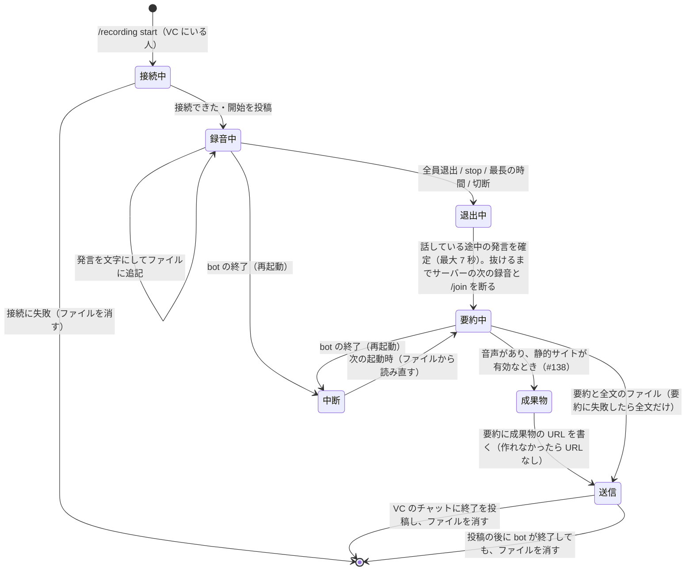

# 会議の録音と文字起こし

Discord のボイスチャンネルの会議を、Teams の録音のように文字起こしして記録する機能（判断記録 #118）。発言は xAI の Speech to Text（Grok Voice API）で、話している間に文字にする。終わったら、サーバーの Text Generation Model が要約を作り、要約と全文のファイルを、録音のコマンドを送ったチャンネルに送る。静的サイトのホスティングが有効なら、音声と全文を成果物のページに 3 日残し、要約の投稿にその URL を書く（判断記録 #138）。

**実際の Discord・xAI では、まだ動かしていない**（2026-10-30 時点）。確かめたのは、Discord と xAI を偽物に置き換えた自動テスト（`apps/bot/src/__tests__/recording.test.ts`・`recording-discord.test.ts`・`recording-audio.test.ts`・`recording-player.test.ts`・`stt.test.ts`・`recording-commands.test.ts`）と、手元の Chromium で成果物のページを開いた確認だけ（下の「音声と成果物」）。

## 使い方

| コマンド           | 内容                                                                                 |
| ------------------ | ------------------------------------------------------------------------------------ |
| `/recording start` | 自分がいるボイスチャンネルの録音を始める。要約はこのコマンドを送ったチャンネルに届く |
| `/recording stop`  | 録音を止める。止められるのは、そのボイスチャンネルにいる人か、録音を始めた人         |
| `/text-model`      | このサーバーの Text Generation Model を表示する。`preset`・`effort` を付けると変える |

ダッシュボードでは、サーバー設定の「ツールと挙動」の「Text Generation Model」で変えられる。

録音は次のどれかで終わる。

- bot 以外の全員がボイスチャンネルから抜けた（ほかの bot だけが残っても終わる）
- `/recording stop`
- 最長の時間（既定 3 時間）に達した
- bot がボイスチャンネルから切断された、またはほかのチャンネルへ移された

## 状態の移り変わり

図は手で描いたもの（`apps/bot/src/recording.ts` の `Recorder` を読んで描いた）。

## 上限

AGENTS.md の費用の規則のため、次の上限がある。数値は #118 で決めた。

| 項目                                      | 既定                                                                               | 環境変数                                                                   |
| ----------------------------------------- | ---------------------------------------------------------------------------------- | -------------------------------------------------------------------------- |
| 1 件の最長の時間                          | 180 分                                                                             | `RECORDING_MAX_MINUTES`（1〜1440）                                         |
| 同時に録音できる数（全サーバーで）        | 2 件                                                                               | `RECORDING_MAX_SESSIONS`（1〜10）                                          |
| 1 つのサーバーで同時に                    | 1 件                                                                               | —（Discord の bot は 1 サーバーで 1 つのボイスチャンネルにしかいられない） |
| 1 件で同時に受信する話者                  | 8 人                                                                               | —（`/join` の通話と同じ）                                                  |
| 1 件で同時に開く xAI の接続               | 16（受信中の話者と、間の後に確定を待っている発言）                                 | —                                                                          |
| 1 つの xAI の接続の長さ                   | 5 分（話し続けていれば、続けて次の接続）                                           | —                                                                          |
| 要約の 1 回のリクエストに入れる文字起こし | 推計 6 万トークン（超えたら区切って要約し、最後にまとめる）                        | —                                                                          |
| 要約のリクエストの数                      | 区切りは 12 まで（呼び出しは区切りの数 + 1）。超えた分は要約に入れず、その旨を書く | —                                                                          |

録音の同時数は、`/join` の通話のセッション（3 まで）とは別に数える。同じサーバーで `/join` 中（接続している途中を含む）は録音を始められず、録音中は `/join` できない（録音中は応答しない）。録音が終わってから bot がボイスチャンネルを抜けるまで（話している途中の発言の確定に最大 7 秒）も、そのサーバーの次の録音と `/join` は断る。

## 使うもの

- `VOICE_ENABLED=true` と `XAI_API_KEY`（`/join` の通話と同じ）。無ければ、コマンドが出ない、または開始を断る
- Text Generation Model のプロバイダーの鍵。選べるのは Anthropic API のモデルだけなので `ANTHROPIC_API_KEY`。無ければ開始を断る（要約できない録音を始めない）
- Discord の権限: bot がボイスチャンネルに接続でき（View Channel・Connect）、コマンドのチャンネルに投稿とファイルの添付ができること

## Text Generation Model

- サーバーごとの設定 `text_model`（`{ preset, effort }`）。既定は Claude Haiku 5.5 / medium
- 選べるのは Anthropic API のプリセット（Haiku / Sonnet / Opus 5.5。Auto と Anthropic Workspace は除く）。Anthropic API のプリセットは Premium 以上が選べる（#35）。ダッシュボード・API・`/text-model` のどれでも同じ確認をする
- 選んだプリセットが後で非公開になったら、既定で動く。effort だけを変えると、既定のモデルと組にして保存する（非公開のプリセットはもう選べないため）。既定（Haiku 5.5）そのものが非公開のときは、effort だけの変更も断られる（ほかのモデルを選ぶ）
- 予算フォールバック（#89・#95）: 閾値を切ったとき、テキスト生成モデルもフォールバックのモデルと effort に書き換える（#121）。フォールバックが Anthropic 以外のモデルなら書き換えない（#146）。送る直前の差し替えはしないので、要約は保存されたモデルで動く。要約の投稿には、動いたモデルを書く
- 利用額は `/usage` の推計に入る（`anthropic` のリクエストとして記録される）

## xAI に送るもの

`wss://api.x.ai/v1/stt`、モデルは `grok-voice-transcribe-2.0`（既定）。話者ごとに、話し始めから間（1.2 秒）までを 1 つの接続で送る。Discord の 48 kHz ステレオを 16 kHz モノラルの PCM にして送る（`/join` の通話と同じ処理、`apps/bot/src/stt.ts`）。

| パラメータ                | 値                               | 理由                                                             |
| ------------------------- | -------------------------------- | ---------------------------------------------------------------- |
| `sample_rate`・`encoding` | `16000`・`pcm`                   | 通話と同じ                                                       |
| `interim_results`         | `false`                          | 確定した文字だけ使う                                             |
| `language`                | `ja`                             | 通話と同じ                                                       |
| `filler_words`            | サーバーの filler removal に従う | 通話と同じ                                                       |
| `smart_turn`・`keyterm`   | 付けない                         | 返事をしないので、話の区切りを待たない。ウェイクワードは要らない |

話者の枠は、Discord の受信が終わった時点（間の後）で空ける。前の発言の確定を待つ間に同じ人が話し始めても、新しい接続で聞く。xAI への接続は、Discord の受信から送る（受信と接続は別に終わる）。話し続けたまま 5 分の区切りに達したときは、同じ受信のまま次の接続で聞く（xAI が文字を返していた接続のときだけ。断られた、またはすぐ閉じられた接続は、話者が間を置くまで繰り返さない。その間も受信は続け、音声は残す）。xAI が準備できないまま、またはエラーで終わった接続が 5 回続くと、コマンドのチャンネルとボイスチャンネルのチャットに 1 回だけ知らせ、録音は続ける。

`speech_final=true` の text を 1 つの発言として記録する。ドキュメントでは、これが発話全体をつないだ text になっている。`speech_final` が来る前に接続が終わったときは、それまでの `is_final=true` の区切りをつないで記録する。

出所: https://docs.x.ai/developers/rest-api-reference/inference/speech-to-text 、https://docs.x.ai/developers/model-capabilities/audio/speech-to-text （2026-10-25 に読んだ）。料金はストリーミング $0.20/時（https://docs.x.ai/developers/models 、同日）。音声を送っている時間（話している時間）の分だけかかる。

## 残すもの・残さないもの

- 音声は、静的サイトのホスティングが有効なときだけ残す（下の「音声と成果物」）。`/join` の通話の音声は残さない
- 発言は、認識するたびに `HIBANA_DATA_DIR/recordings/<サーバー ID>-<開始時刻>.jsonl` に追記する（開始の情報・参加者・発言・終了の理由）。送った後に消す。送れなかったときも消し、ログには件数と時間だけを残す（本文は残さない）
- bot が終了する（再起動・デプロイ）と、録音中のものはファイルのまま残し、次の起動で「再起動で中断」として要約と全文を送ってから消す。録音は自動で再開しない。要約の途中で終了したものは、終了の理由を保ったまま次の起動で送る。要約を投稿した後に終了したものは、ファイルを消す（次の起動でもう一度投稿しない）。次の起動で 1 件が送れなくても、ほかは送る
- ほかの bot の音声は記録しない。利用停止（blocked）の人の発言は記録する（操作はできない）（#118）

## 音声と成果物

判断記録 #138。会議の音声を後から聞き直し、ダウンロードできるようにする。VPS（1 vCPU）では音声を再エンコードせず、重ねる処理は、ページを開いた人のブラウザで行う。

### 録音中

- 話者ごとに、Discord から届いた Opus のパケットを、そのまま Ogg に入れて `HIBANA_DATA_DIR/recordings/<id>.audio/s<n>.ogg` に追記する（`apps/bot/src/recording-audio.ts`）。`<n>` は、その録音で話した順の番号
- 1 つのファイルは「チャンク」の並び。チャンクは、それだけで再生できる Ogg Opus のストリームで、最長 60 秒。10 秒を超えた後の間で区切る。書いたチャンクごとに、話者・ファイルの中の位置・開始の時刻・長さを、`<id>.jsonl` に `audio` の行として追記する。再起動で失うのは、書き終わっていないチャンク（話者ごとに最長 60 秒）だけ
- Discord は、1.2 秒より短い間ではパケットを送らない。届いた時刻から間を測り、100 ms 以上の間は無音（20 ms で 3 バイト）で埋めて、会議の時刻にそろえる。100 ms より短い遅れは、ネットワークの揺れとして埋めない。チャンクの開始は、最初のパケットが届いた時刻
- 音声は、Discord の受信が続く限り残す。xAI が接続を断っても、話者が間を置くまで受信を続ける（xAI にはその間、送り直さない）
- 開始の投稿で、音声も保存し、終了後 3 日の間、URL を知っていればだれでも聞けるページに置くと知らせる

### 終わったら

- 要約を投稿する前に、音声を成果物にする。成果物のディレクトリには `index.html`・`player.js`（`apps/bot/src/recording-player/player.ts` を `Bun.build` でまとめたもの）・`manifest.json`・`audio/s<n>.ogg` を置く。`manifest.json` には、表示名・時刻・全文を入れ、Discord の ID は入れない
- 要約の投稿に、成果物の URL と消える日時を書く。成果物を作れなかったときは URL を書かずに投稿する
- 成果物を作った後、投稿の前に bot が終了したときは、`<id>.jsonl` に書いた URL を、次の起動の投稿で使う（成果物を作り直さない）
- 成果物の一覧（ダッシュボードの「成果物」）では「録音」と表示する。1 ヶ月延命・永久化はできない（bot・API・ダッシュボードのどれでも断る。API は 409）。削除はできる

### ページ

- 画面: 上から、タイトルと情報（サーバー・開始・長さ・参加者・消える日時）、再生のカード（広い画面ではスクロールしても上に残る）、ダウンロード、全文。ライトとダークの両方に合わせる
- 話者の色: 検証済みのカテゴリ配色 8 色を、話した順に固定で割り当てる（ライトとダークで別の段階）。9 人目からは灰色。色だけで区別させないよう、レーンと全文の行には名前を書く
- タイムライン: 話者ごとのレーンに、音声の残っている区間を描く（区間にカーソルを置くと時刻が出る）。レーンをクリックすると、その位置へ移る。再生位置の線とスライダーのつまみは同じ位置に出る
- 再生: Web Audio API で、各チャンクを会議の時刻に予約して重ねる。チャンクは、話者のファイルから Range リクエストで取り、再生位置の 15 秒先までを取る。聞く人をチップで選べる。10 秒戻る・進むのボタンがある
- 全文: 再生中の行を強調し、「再生位置に追従」がオンなら、その行までスクロールする。行の時刻を押すと、そこから全員を再生する。検索で行を絞り込める
- 全文の各行の ▶ は、その人の音声だけを、その行の少し前（0.3 秒）から、その人の次の行（無ければ、その発言の終わり）まで再生する
- ダウンロード: 「全員を重ねた 1 本」か「話者ごと」。1 分ずつ `OfflineAudioContext` で重ね、WebCodecs の `AudioEncoder` で Opus（48 kHz・モノラル・64 kbps）にして Ogg に詰める。`AudioEncoder` で Opus を使えないブラウザでは WAV（16 kHz・モノラル・16 bit、1 時間で約 115 MB）
- 静的サイトの配信（`apps/bot/src/tools/sites.ts`）は、1 つの範囲の Range リクエストに 206 で答える
- ページは、成果物ごとのオリジン（`STATIC_SITE_ORIGIN_TEMPLATE`）で配信する前提。共有のホストでは CSP の sandbox で `allow-same-origin` を付けないので、ページから `manifest.json` を取れない

### 上限

| 項目                       | 既定                                                            | 環境変数                              |
| -------------------------- | --------------------------------------------------------------- | ------------------------------------- |
| 音声の合計（録音中を含む） | 1 GB（1,000,000,000 バイト）。0 で音声を残さない                | `RECORDING_AUDIO_MAX_BYTES`           |
| 成果物を残す時間           | 72 時間                                                         | `RECORDING_AUDIO_TTL_HOURS`（1〜720） |
| `publish_site` の上限      | 録音は数えない（1 サイト 50 MB・サーバーごと 50 件・合計 2 GB） | `STATIC_SITE_MAX_*`                   |

- 合計を超えるときは、古い録音の成果物から消す。消せるものが無ければ、録音中の音声の保存を止め、コマンドのチャンネルとボイスチャンネルのチャットに 1 回だけ知らせる。文字起こしと要約は続ける
- 再起動の後に送る録音は、その前のプロセスで取った分を数えていないので、成果物にした後に、ほかの古い録音を消して合計に収める
- 目安: Discord の既定の 64 kbps で、発話 1 時間に約 29 MB。1 GB で約 35 時間（3 日なら 1 日約 12 時間）。VPS のディスクは 24 GB、空き 4.9 GB（2026-10-30）

### 確かめたこと（2026-10-30）

手元で、`opusscript` で作った Opus（2 人。発言の中の 0.6 秒の間と、2 人が重なる 1 秒を含む 14 秒）から、`Recorder` と `Sites` で成果物を作り、`http://<token>.localhost:8899/` で配信して、Playwright 1.63 の Chromium（headless）で開いた。

- 再生が進み、全文の行の ▶ は、その人の発言の終わりで止まった。音声は Range（206）で取られた
- 「全員を重ねた 1 本」と「話者ごと」のダウンロードは、どちらも Opus・48 kHz・モノラル・14.02 秒（ffprobe）。重ねた 1 本を解析すると、発言の中の間（2.0〜2.6 秒）は無音、重なった 4〜5 秒は 2 人の音が同じ大きさで入っていた

確かめていないこと:

- Safari・Firefox（Ogg Opus の `decodeAudioData`、`AudioEncoder` の Opus）。WAV に切り替わる経路は、ブラウザで動かしていない
- 実際の Discord で、届いた時刻から間を埋めたときのずれ
- 長い会議（3 時間）のダウンロードにかかる時間と、スマートフォンのメモリ

## 投稿の形

- 開始: コマンドのチャンネルと、ボイスチャンネルのテキストチャット（コマンドをそこから送ったときは 1 回）に、だれが始めたか、xAI に送ること、音声を残すかどうか（#138）、要約の送り先、止め方を投稿する
- 終了: コマンドのチャンネルに、要約（Discord の 2,000 文字を超えたら分けて投稿）と、全文のファイル `transcript-YYYYMMDD-HHMM.txt`（日時は日本時間）。その後に、ボイスチャンネルのチャットに終了と要約の送り先。コマンドのチャンネルに送れなかったときは、ボイスチャンネルのチャットにその旨を投稿する（ファイルは消す）
- 全文のファイルは、先頭にサーバー・ボイスチャンネル・開始と終了の時刻（JST）・時間・終了の理由・参加者、その後に 1 行 1 発言で `[経過時間] 表示名: 発言`
- 要約は、概要・決定事項・ToDo・論点と未決事項の見出しで、日本語（会議が明らかに別の言語のときは、その言語）
- 投稿はメンションで通知しない（`allowedMentions` を空にする）

## 検証していないこと

- 実際の Discord での受信（DAVE の暗号化の下での話者ごとの音声）と、ボイスチャンネルの出入りでの終了
- 実際の xAI の応答の形（`speech_final` の text が発話全体か）。1 つの接続の最長時間・同時接続数・レート制限はドキュメントに無い
- 長い会議での要約の質と、区切って要約したときの質
- Discord の Developer Policy の現行の本文（取得できなかった）に対して、開始の投稿で通知が足りるか
