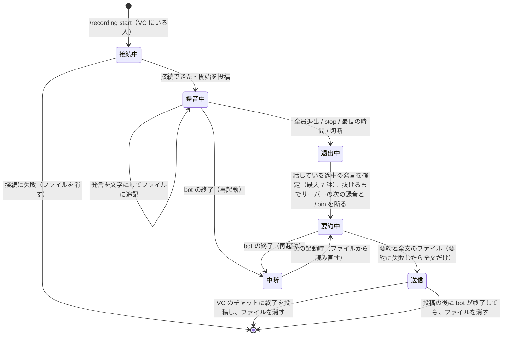

# 会議の録音と文字起こし

Discord のボイスチャンネルの会議を、Teams の録音のように文字起こしして記録する機能（判断記録 #118）。発言は xAI の Speech to Text（Grok Voice API）で、話している間に文字にする。終わったら、サーバーの Text Generation Model が要約を作り、要約と全文のファイルを、録音のコマンドを送ったチャンネルに送る。

**実際の Discord・xAI では、まだ動かしていない**（2026-10-25 時点）。確かめたのは、Discord と xAI を偽物に置き換えた自動テストだけ（`apps/bot/src/__tests__/recording.test.ts`・`stt.test.ts`・`recording-commands.test.ts`）。

## 使い方

| コマンド           | 内容                                                                                 |
| ------------------ | ------------------------------------------------------------------------------------ |
| `/recording start` | 自分がいるボイスチャンネルの録音を始める。要約はこのコマンドを送ったチャンネルに届く |
| `/recording stop`  | 録音を止める。止められるのは、そのボイスチャンネルにいる人か、録音を始めた人         |
| `/text-model`      | このサーバーの Text Generation Model を表示する。`preset`・`effort` を付けると変える |

ダッシュボードでは、サーバー設定の「ツールと挙動」の「Text Generation Model」で変えられる。

録音は次のどれかで終わる。

- bot 以外の全員がボイスチャンネルから抜けた（ほかの bot だけが残っても終わる）
- `/recording stop`
- 最長の時間（既定 3 時間）に達した
- bot がボイスチャンネルから切断された、またはほかのチャンネルへ移された

## 状態の移り変わり

図は手で描いたもの（`apps/bot/src/recording.ts` の `Recorder` を読んで描いた）。

## 上限

AGENTS.md の費用の規則のため、次の上限がある。数値は #118 で決めた。

| 項目                                      | 既定                                                                               | 環境変数                                                                   |
| ----------------------------------------- | ---------------------------------------------------------------------------------- | -------------------------------------------------------------------------- |
| 1 件の最長の時間                          | 180 分                                                                             | `RECORDING_MAX_MINUTES`（1〜1440）                                         |
| 同時に録音できる数（全サーバーで）        | 2 件                                                                               | `RECORDING_MAX_SESSIONS`（1〜10）                                          |
| 1 つのサーバーで同時に                    | 1 件                                                                               | —（Discord の bot は 1 サーバーで 1 つのボイスチャンネルにしかいられない） |
| 1 件で同時に受信する話者                  | 8 人                                                                               | —（`/join` の通話と同じ）                                                  |
| 1 件で同時に開く xAI の接続               | 16（受信中の話者と、間の後に確定を待っている発言）                                 | —                                                                          |
| 1 つの xAI の接続の長さ                   | 5 分（話し続けていれば、続けて次の接続）                                           | —                                                                          |
| 要約の 1 回のリクエストに入れる文字起こし | 推計 6 万トークン（超えたら区切って要約し、最後にまとめる）                        | —                                                                          |
| 要約のリクエストの数                      | 区切りは 12 まで（呼び出しは区切りの数 + 1）。超えた分は要約に入れず、その旨を書く | —                                                                          |

録音の同時数は、`/join` の通話のセッション（3 まで）とは別に数える。同じサーバーで `/join` 中（接続している途中を含む）は録音を始められず、録音中は `/join` できない（録音中は応答しない）。録音が終わってから bot がボイスチャンネルを抜けるまで（話している途中の発言の確定に最大 7 秒）も、そのサーバーの次の録音と `/join` は断る。

## 使うもの

- `VOICE_ENABLED=true` と `XAI_API_KEY`（`/join` の通話と同じ）。無ければ、コマンドが出ない、または開始を断る
- Text Generation Model のプロバイダーの鍵。選べるのは Anthropic API のモデルだけなので `ANTHROPIC_API_KEY`。無ければ開始を断る（要約できない録音を始めない）
- Discord の権限: bot がボイスチャンネルに接続でき（View Channel・Connect）、コマンドのチャンネルに投稿とファイルの添付ができること

## Text Generation Model

- サーバーごとの設定 `text_model`（`{ preset, effort }`）。既定は Claude Haiku 5.5 / medium
- 選べるのは Anthropic API のプリセット（Haiku / Sonnet / Opus 5.5。Auto と Anthropic Workspace は除く）。Anthropic API のプリセットは Premium 以上が選べる（#35）。ダッシュボード・API・`/text-model` のどれでも同じ確認をする
- 選んだプリセットが後で非公開になったら、既定で動く。effort だけを変えると、既定のモデルと組にして保存する（非公開のプリセットはもう選べないため）。既定（Haiku 5.5）そのものが非公開のときは、effort だけの変更も断られる（ほかのモデルを選ぶ）
- 予算フォールバック（#89・#95）: 閾値を切ったとき、テキスト生成モデルもフォールバックのモデルと effort に書き換える（#121）。送る直前の差し替えはしないので、要約は保存されたモデルで動く。要約の投稿には、動いたモデルを書く
- 利用額は `/usage` の推計に入る（`anthropic` のリクエストとして記録される）

## xAI に送るもの

`wss://api.x.ai/v1/stt`、モデルは `grok-voice-transcribe-2.0`（既定）。話者ごとに、話し始めから間（1.2 秒）までを 1 つの接続で送る。Discord の 48 kHz ステレオを 16 kHz モノラルの PCM にして送る（`/join` の通話と同じ処理、`apps/bot/src/stt.ts`）。

| パラメータ                | 値                               | 理由                                                             |
| ------------------------- | -------------------------------- | ---------------------------------------------------------------- |
| `sample_rate`・`encoding` | `16000`・`pcm`                   | 通話と同じ                                                       |
| `interim_results`         | `false`                          | 確定した文字だけ使う                                             |
| `language`                | `ja`                             | 通話と同じ                                                       |
| `filler_words`            | サーバーの filler removal に従う | 通話と同じ                                                       |
| `smart_turn`・`keyterm`   | 付けない                         | 返事をしないので、話の区切りを待たない。ウェイクワードは要らない |

話者の枠は、Discord の受信が終わった時点（間の後）で空ける。前の発言の確定を待つ間に同じ人が話し始めても、新しい接続で聞く。話し続けたまま 5 分の区切りに達したときは、続けて次の接続で聞く（xAI が文字を返していた接続のときだけ。断られた、またはすぐ閉じられた接続を、話している間ずっと繰り返さない）。xAI が準備できないまま、またはエラーで終わった接続が 5 回続くと、コマンドのチャンネルとボイスチャンネルのチャットに 1 回だけ知らせ、録音は続ける。

`speech_final=true` の text を 1 つの発言として記録する。ドキュメントでは、これが発話全体をつないだ text になっている。`speech_final` が来る前に接続が終わったときは、それまでの `is_final=true` の区切りをつないで記録する。

出所: https://docs.x.ai/developers/rest-api-reference/inference/speech-to-text 、https://docs.x.ai/developers/model-capabilities/audio/speech-to-text （2026-10-25 に読んだ）。料金はストリーミング $0.20/時（https://docs.x.ai/developers/models 、同日）。音声を送っている時間（話している時間）の分だけかかる。

## 残すもの・残さないもの

- 音声は保存しない
- 発言は、認識するたびに `HIBANA_DATA_DIR/recordings/<サーバー ID>-<開始時刻>.jsonl` に追記する（開始の情報・参加者・発言・終了の理由）。送った後に消す。送れなかったときも消し、ログには件数と時間だけを残す（本文は残さない）
- bot が終了する（再起動・デプロイ）と、録音中のものはファイルのまま残し、次の起動で「再起動で中断」として要約と全文を送ってから消す。録音は自動で再開しない。要約の途中で終了したものは、終了の理由を保ったまま次の起動で送る。要約を投稿した後に終了したものは、ファイルを消す（次の起動でもう一度投稿しない）。次の起動で 1 件が送れなくても、ほかは送る
- ほかの bot の音声は記録しない。利用停止（blocked）の人の発言は記録する（操作はできない）（#118）

## 投稿の形

- 開始: コマンドのチャンネルと、ボイスチャンネルのテキストチャット（コマンドをそこから送ったときは 1 回）に、だれが始めたか、xAI に送ること、要約の送り先、止め方を投稿する
- 終了: コマンドのチャンネルに、要約（Discord の 2,000 文字を超えたら分けて投稿）と、全文のファイル `transcript-YYYYMMDD-HHMM.txt`（日時は日本時間）。その後に、ボイスチャンネルのチャットに終了と要約の送り先。コマンドのチャンネルに送れなかったときは、ボイスチャンネルのチャットにその旨を投稿する（ファイルは消す）
- 全文のファイルは、先頭にサーバー・ボイスチャンネル・開始と終了の時刻（JST）・時間・終了の理由・参加者、その後に 1 行 1 発言で `[経過時間] 表示名: 発言`
- 要約は、概要・決定事項・ToDo・論点と未決事項の見出しで、日本語（会議が明らかに別の言語のときは、その言語）
- 投稿はメンションで通知しない（`allowedMentions` を空にする）

## 検証していないこと

- 実際の Discord での受信（DAVE の暗号化の下での話者ごとの音声）と、ボイスチャンネルの出入りでの終了
- 実際の xAI の応答の形（`speech_final` の text が発話全体か）。1 つの接続の最長時間・同時接続数・レート制限はドキュメントに無い
- 長い会議での要約の質と、区切って要約したときの質
- Discord の Developer Policy の現行の本文（取得できなかった）に対して、開始の投稿で通知が足りるか
