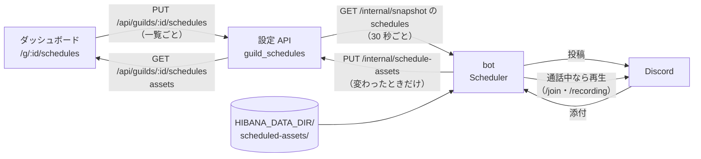

# 定時アクション

サーバーごとに、毎日決まった時刻に、チャンネルへの投稿と、通話中なら音声の再生をする（判断記録: [#163](https://github.com/hsincode/hibana/issues/163)）。実行時にモデルは呼ばない。

## 仕様

| 項目         | 値                                                                                                                                 |
| ------------ | ---------------------------------------------------------------------------------------------------------------------------------- |
| トリガー     | 毎日 `HH:MM`（24 時間）と IANA タイムゾーン。タイムゾーンの既定は `Asia/Tokyo`                                                     |
| アクション   | `post`（チャンネルに本文と、画像または動画 1 つ）と `voice_clip`（通話中なら音声を鳴らす）。1 件に 4 つまで、書いた順に行う        |
| 件数         | 1 サーバー 10 件まで                                                                                                               |
| 実行の窓     | 時刻から 2 分以内（bot は 15 秒ごとに見る）。それを過ぎた日は送らない                                                              |
| 二重送信     | 件ごとに、最後に実行した「日付と時刻」を `HIBANA_DATA_DIR/schedules_state.json` に、送る前に書く。再起動しても同じ日に二度送らない |
| 編集できる人 | Discord の「サーバー管理」か「管理者」権限を持つ人、サーバーのオーナー、hibana の Administrator・Moderator。メンバーは見るだけ     |
| 止める       | 有効を OFF にした件と、`bot_disabled` のサーバーは何もしない                                                                       |

- 時刻を後ろへずらすと、その日のうちに新しい時刻でもう一度動く（最後の実行は「日付と時刻」で覚える）
- 夏時間で存在しない時刻（例: 2026-03-08 の `America/New_York` の 02:30）は、その日は動かない。2 回ある時刻は 1 回だけ動く
- 失敗したアクションはログに出し、残りのアクションは続ける

### 投稿（`post`）

- 投稿先は、そのサーバーのテキストチャンネルかアナウンスチャンネル。ほかのサーバーのチャンネルは、保存はできても実行時に断る
- bot に「チャンネルを見る」「メッセージを送信」、添付があれば「ファイルを添付」の権限が要る
- メンションは通知しない（`allowedMentions: { parse: [] }`）
- 本文か添付のどちらかが要る。本文は 2,000 文字まで

### 通話中なら音声（`voice_clip`）

- bot がそのサーバーで `/join` の通話か `/recording` の録音をしているときだけ鳴らす。音声のためにボイスチャンネルへは入らない
- `/join` の通話では、答えの音声と同じ順番待ちに並ぶ。再生中の音声は止めず、その後に鳴らす
- 録音中は、鳴らす間だけミュートを外し、終わったらミュートに戻す（#118 の「録音は話さない」を #163 で変えた）
- 録音中に鳴らした音声は、bot の発言として録音に入れる（#163、2026-11-08 の追記）。Discord は bot が送った音声をその bot に返さないので、プレイヤーが送る Opus のパケット（20 ms ごと）を、送るときに受け取る
  - 残す音声: パケットを作り直さずに、bot の音声として残す。成果物のページでは、ほかの話者と同じく再生・ミックスされる
  - 文字起こし: 同じパケットを xAI の 1 本のストリームで文字起こしし、bot の名前の発言として文字起こしと要約に入れる。音声は 5 分で打ち切るので、1 本で足りる。音楽や効果音は、何も文字にならないことがある
  - xAI のストリームが 16 本開いているときは、音声だけ残し、文字起こしはしない（録音の上限、#118）。録音を終えるときは、この文字起こしも、話者の発言と同じく終わるのを待つ
- 5 分で打ち切る
- ファイルは ffmpeg で Discord の音声に変換する。形式は問わない

## 素材の置き場所

画像・動画・音声はリポジトリにも DB にも入れない。bot を動かすマシンの次の場所に置く。Discord の `/schedule-asset` で上げるか（#168）、手で置く。

```
HIBANA_DATA_DIR/scheduled-assets/<サーバー ID>/<ファイル名>
```

- 本番では `/var/lib/hibana/scheduled-assets/<サーバー ID>/`。`hibana` ユーザーが読めること
- ファイル名は英数字で始まり、英数字・`.`・`_`・`-` だけ。サブディレクトリと、名前が `.` で始まるファイルは使わない
- 種類は拡張子で決める

| 種類 | 拡張子                                | 上限  |
| ---- | ------------------------------------- | ----- |
| 画像 | `png` `jpg` `jpeg` `gif` `webp`       | 10 MB |
| 動画 | `mp4` `webm` `mov`                    | 10 MB |
| 音声 | `ogg` `opus` `mp3` `wav` `m4a` `flac` | 20 MB |

- 10 MB は、ブーストのないサーバーで bot が送れる大きさ
- bot は 1 分ごとにこの場所を見て、変わっていれば一覧を設定 API に送る（`PUT /internal/schedule-assets`）。ダッシュボードはその一覧から選ぶ
- 一覧にない名前を保存した件は、実行時に「見つからない」とログに出し、そのアクションを飛ばす
- 素材の出所とライセンスは、置く人が記録する（AGENTS.md「持ち込まないもの」）

### Discord から上げる（`/schedule-asset`、判断記録 #168）

| サブコマンド             | すること                                                                                         | 使える人                           |
| ------------------------ | ------------------------------------------------------------------------------------------------ | ---------------------------------- |
| `add file:<添付> [name]` | 添付したファイルを、`name`（省略するとファイルの名前）で置き場所に保存する。同じ名前は置き換える | そのサーバーを管理できる人（#166） |
| `list`                   | このサーバーの素材の一覧と、使っている容量                                                       | サーバーの全員                     |
| `remove name`            | 素材を消す                                                                                       | そのサーバーを管理できる人         |

- 名前・種類・1 件の上限は、手で置く素材と同じ。添付の名前が規則に合わない（日本語の名前など）ときは、`name` を指定するよう断る。`name` で種類を変える（画像を `.mp3` にする）ことはできない
- 容量は 1 つのサーバーで合計 200 MB・200 件、すべてのサーバーで合計 1 GB まで（`SCHEDULE_ASSETS_GUILD_MAX_BYTES`・`SCHEDULE_ASSETS_TOTAL_MAX_BYTES`）。手で置いた素材も数え、置き換える素材は差し引く。上限を超える追加は断る。VPS のディスクの空き（2026-11-08 に 4.2 GB）と、会議の録音の音声（最大 1 GB）から決めた
- 大きさは、Discord が伝える大きさで取りに行く前に確かめ、取りながらもう一度確かめる。取ったファイルは、名前が `.` で始まる一時ファイルに書いてから置き場所に移すので、bot が書きかけを読むことはない
- 追加と削除は 1 つずつ行う。保存すると、bot は次の確認（15 秒以内）で一覧を設定 API に送る
- 消した素材を使う定時アクションは、実行時に「見つからない」とログに出し、そのアクションを飛ばす
- Discord の添付の上限（Nitro の無い人は 10 MB）を超える音声は、手で置く

## データの流れ



- 設定 API は `guild_schedules`（サーバー ID と、一覧の JSONB）に置く。`PUT /internal/snapshot` は `guilds` を丸ごと置き換えるので、別の表にした
- 保存のたびに snapshot の版を上げる。bot には最大 30 秒で届く
- ダッシュボードのチャンネル一覧は、設定 API が Discord の REST（bot のトークン）から取る（`GET /api/guilds/:id/channels`、1 分キャッシュ）

## 運用

- VPS に ffmpeg が要る（今の VPS は Arch Linux なので `pacman -S ffmpeg`）。無いと、音声のアクションは失敗してログに出る。投稿は動く
- Docker イメージには ffmpeg を入れてある（`Dockerfile`）

## 検証の範囲

- 自動テスト: スキーマと API（`apps/api/src/schedules.test.ts`、Postgres は `postgres-store.test.ts`）、時刻の判定と実行（`apps/bot/src/__tests__/schedules.test.ts`）、Discord への投稿と再生先（`schedule-discord.test.ts`）、録音中の再生と、その音声が録音に入ること（`recording-discord.test.ts`、`recording.test.ts`）、ダッシュボード（`apps/web/tests/design.spec.ts`、Chromium）、`/schedule-asset`（`schedule-assets.test.ts`。Discord の CDN は偽物、ファイルは一時ディレクトリに本当に書く）
- 手元で、48 kHz ステレオの WAV（4.07 秒）と MP4（VP9・FLAC、4.07 秒）が、bot と同じ `createAudioResource(path)` で ffmpeg を通り、Opus 204 パケット（4.08 秒）になることを確かめた
- 本物の Discord では動かしていない。`/join` の通話での順番待ち（`apps/bot/src/voice.ts`）には自動テストがない。録音中に鳴らした音声が録音に入ることは、偽物のプレイヤーと xAI で確かめただけ。`/schedule-asset` は、本物の Discord の添付では試していない
