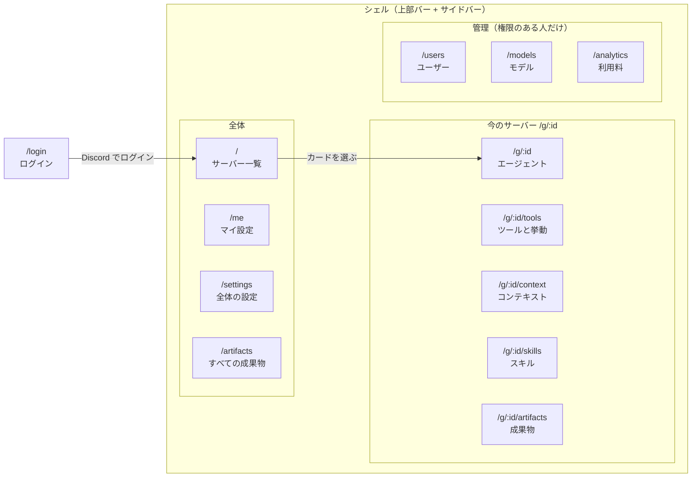
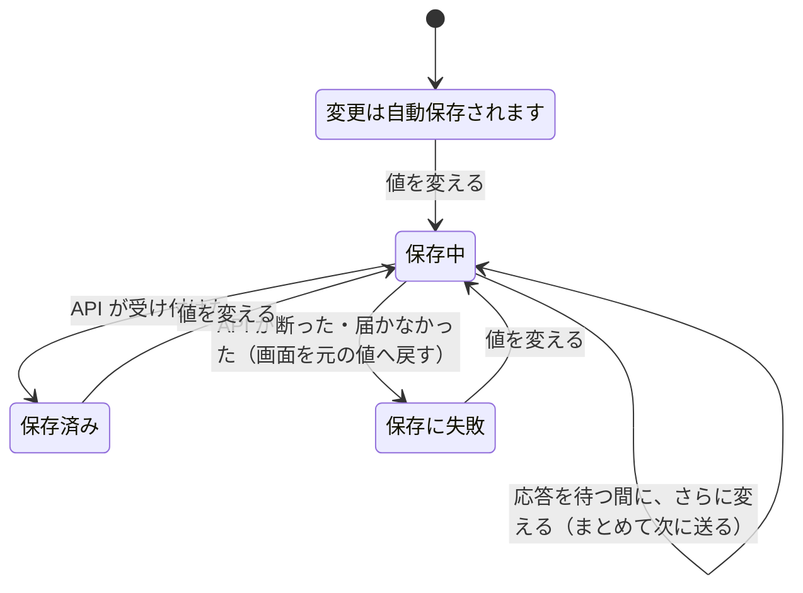

# Web ダッシュボードの構成と見た目

`apps/web` の画面の分け方、保存の見せ方、見た目の決まりをまとめます。判断の経緯は、構成が #61、今の見た目が #142 にあります。図はこの文書のために手で描いたもので、実装から生成したものではありません。

## 画面の分け方

上部バーとサイドバー（シェル）の中に、ページが 1 つ入ります。サイドバーは上から「今のサーバー」の 5 ページ、全体、管理の順です。1000px 以下ではサイドバーが引き出しになり、サーバーのページには同じ 5 ページのタブ帯が出ます。



| URL                | ページ         | 中身                                                                                                                                                                                                              | 開ける人                                                                                                                               |
| ------------------ | -------------- | ----------------------------------------------------------------------------------------------------------------------------------------------------------------------------------------------------------------- | -------------------------------------------------------------------------------------------------------------------------------------- |
| `/login`           | ログイン       | Discord でログイン                                                                                                                                                                                                | 未ログイン                                                                                                                             |
| `/`                | サーバー一覧   | 開けるサーバーのカード、名前と ID の絞り込み                                                                                                                                                                      | ログイン済み                                                                                                                           |
| `/g/:id`           | エージェント   | 「実際の動作」、`/switch` モデル（モデル・effort・Service Tier）、サブエージェント（モード・共通の設定・役割ごとの設定）、Jev                                                                                     | そのサーバーのメンバー（API が判定）。変えられるのは、そのサーバーを管理できる人だけ（#166）。ほかのメンバーには部品を無効にして見せる |
| `/g/:id/tools`     | ツールと挙動   | 外部 MCP の on / off、挙動（server-tools・thread-only・URL previews・Text Generation Model）、トリガーワード。temperature などは全体の設定へ移した（#161）                                                        | 同上                                                                                                                                   |
| `/g/:id/context`   | コンテキスト   | サーバーコンテキスト、persona override                                                                                                                                                                            | 同上                                                                                                                                   |
| `/g/:id/skills`    | スキル         | 一覧、作成、他サーバーからのインポート、有効・無効、削除、ダウンロード                                                                                                                                            | 同上                                                                                                                                   |
| `/g/:id/artifacts` | 成果物         | このサーバーの公開サイトと会議の録音（#138）、延命・永久化・解除（録音はできない）                                                                                                                                | 同上                                                                                                                                   |
| `/me`              | マイ設定       | 「あなたの上書き」、モデル・サブエージェント・Jev の上書き、ユーザーコンテキスト                                                                                                                                  | ログイン済み                                                                                                                           |
| `/settings`        | 全体の設定     | temperature・exa・スレッド履歴と要約・MCP サーバー URL・voice-mode・filler removal（#161）、予算が少ないときのモデルと閾値（#89、#95。閾値を切ったときに設定を書き換える、#121。#161 で利用料のページから移した） | ログイン済み。変更は Moderator 以上（`can_manage_app_settings`、`canManageBudget`、#161）。それ以外の人には部品を無効にして見せる      |
| `/artifacts`       | すべての成果物 | 開けるサーバー全部の公開サイトと会議の録音。延命・永久化は、管理できるサーバーのものだけ（#166）                                                                                                                  | ログイン済み                                                                                                                           |
| `/users`           | ユーザー       | ロールの変更                                                                                                                                                                                                      | `can_manage_users`                                                                                                                     |
| `/models`          | モデル         | ChatGPT マスターアカウント、プリセットの公開とプレミアム                                                                                                                                                          | `can_manage_users`                                                                                                                     |
| `/analytics`       | 利用料         | Anthropic の cost report と、今日の推計（usage report）、利用状況（#110）。予算が少ないときのモデルと閾値は全体の設定にある（#161）                                                                               | ログイン済み（`can_view_analytics`、#85）。利用状況は Administrator だけ（`can_view_usage`、#110）                                     |

サーバーのページ（`/g/:id` から `/g/:id/artifacts`）の権限は次のとおりです（判断記録: #166）。

- 開けるのは、そのサーバーのメンバー（ユーザーの Discord のサーバー一覧と bot のサーバー一覧の両方にあるサーバー）と、bot のいるすべてのサーバーの Administrator・Moderator
- 変えられるのは、そのサーバーを管理できる人: Discord の「サーバー管理」か「管理者」の権限を持つ人、サーバーのオーナー、Administrator・Moderator。API は、ほかの人の書き込み（`PATCH /api/guilds/:id/settings`・`POST /api/guilds/:id/skills`・`PATCH /api/guilds/:id/artifacts/:token`）を 403 で断る。読み込みの応答の `can_edit`（サーバーの一覧では `can_manage`）で、画面が部品を無効にする
- 判定は、開けるかどうかと同じ Discord の `/users/@me/guilds` の応答（`owner`・`permissions`）で行い、Discord への問い合わせは増やさない
- サーバー単位の停止（`bot_disabled`）を変えられるのは Administrator・Moderator だけ（#64）。それを含む保存は、ほかの項目も保存せずに 403 で断る
- bot の側でも同じ規則にしている。サーバーの設定を変えるスラッシュコマンド（`/switch`・`/server-context`・`/server-tools`・`/thread-only`・`/suppress-embeds`・`/text-model`、サーバーの中の `/user-context`）と、会話で設定を変えるツール（`set_bot_model`・`set_triggers`、サーバーの中の `set_user_context`）は、管理できる人でなければ断る（`apps/bot/src/guild-permission.ts`）。値を読むだけの使い方は誰でもできる
- 自動テスト（`apps/api/src/guild-manage.test.ts`、`apps/bot/src/__tests__/guild-permission.test.ts`、`apps/web/tests/design.spec.ts`）は、Discord の応答を偽物にして確かめている。本物の Discord と OAuth では動かしていない

ページの一覧は `apps/web/src/nav.ts` にあり、サイドバー・タブ帯・コマンドパレットが同じ一覧を使います。

### 「今のサーバー」

サイドバーの 5 ページがどのサーバーを指すかは、URL が `/g/:id` のときはその `id`、それ以外のページでは最後に見ていたサーバーです（ブラウザの `localStorage` の `hibana-guild`。無ければ一覧の先頭）。サイドバーの上のボタンで切り替えます。切り替えると、同じ種類のページのまま別のサーバーへ移ります。

### コマンドパレット

上部バーの「検索・移動」か `Ctrl K`（Mac は `⌘K`）で開きます。サーバー、ページ、今のサーバーの設定項目を 1 つの入力欄から探せます。候補は読み込み済みの一覧から作るので、パレットのための通信はしません。設定項目を選ぶと、そのページへ移って行に目印が付き、部品にフォーカスが移ります。設定項目の一覧は `nav.ts` の `GUILD_SETTINGS` で、行のキー（`data-row`）と対応させています。

### 以前の URL

- `/g/:id#mcp` のような、1 ページだった頃の節へのリンクは、その節があるページへ送ります（`nav.ts` の `LEGACY_SECTION_PAGE`）。`#model` `#agents` `#jev` はエージェントのページに残っています。
- `/skills`（サーバーを選ぶ欄つきのページ）は、今のサーバーの `/g/:id/skills` へ送ります。

## 全体の設定

`/settings` の値は、すべてのサーバーと DM に使われます（#161）。サーバーごとには変えられません。対象は temperature・exa・スレッド履歴の保持・スレッドの要約の方式と大きさ・MCP サーバー URL・voice-mode・filler removal で、本番でサーバーごとの分けが使われていなかったものです（判断は #161）。外部 MCP を使うかどうかは、サーバーごとの設定のまま残しています。

- 保存先は設定 API の `meta` の `app_settings` です。bot へはスナップショットの `app_settings` で届きます。Discord の `/temperature`・`/exa`・`/thread-history`・`/voice-mode`・`/filler-words` と、bot の `set_thread_history` も同じ値を変えます。どれも Moderator と Administrator だけが変えられ、DM からも使えます。
- 最初の値は、移した時点のサーバーの行で最も多かった値です（同数なら既定値）。API の起動時に一度だけ作ります（`apps/api/src/store.ts` の `installAppSettings`）。
- 1 つ前の版の bot とダッシュボードのために（[ADR-0006](adr/0006-roll-back-the-bot-alone.md)）、サーバーの行にも同じ項目が残っています。行の値は移した時点のまま変わらず、API はサーバーの行を返すときに全体の値を重ねます。サーバーの設定の保存（PATCH）は、これらの項目を受け付けたうえで無視します。行とスキーマから消すのは、次の配信です。

## 保存の見せ方

設定行（エージェント・ツールと挙動・コンテキスト・マイ設定・全体の設定）は、変えた時点で保存します。往復を待たずに画面を更新し、失敗したら最後にサーバーが受け付けた値へ戻します（`apps/web/src/settings.tsx` の `useOptimisticPatch`）。コンテキストの文章だけは、明示的な「保存」で送ります。

結果は 2 か所に出ます。成功のトーストは出しません。失敗のときだけ、理由を読めるようにトーストも出します。

- 変えた行の右端の印（保存中・保存済み・保存に失敗）。保存済みの印からは琥珀の火花が 1 回散り、印は 3.2 秒で消えます。
- 上部バーの保存状態。保存済みのときは、印から同じ火花が散り、「bot への反映は最大 30 秒」を添えます。bot は 30 秒ごとに設定を取りに来るためで（[本番環境](production.md)）、届いたかどうかを知る API は無いので、上限だけを案内しています。



サーバーを切り替えると、保存状態は最初に戻ります。前のサーバーへの保存の応答が後から届いても、今のサーバーの画面には反映しません。

数値と URL の欄は、フォーカスを外した時点で保存します。値が変わっていなければ何も送りません。

## 「実際の動作」

エージェントのページの先頭に、保存した値ではなく、設定の組み合わせから決まる値を出します（`apps/web/src/Agent.tsx` の `guildEffective`）。bot の環境変数や接続の状態までは Web から分からないので、見出しの横でそう断っています。

| 条件                                                                                           | 表示                                                                                                                                                            | 根拠                                                                                                                                                                         |
| ---------------------------------------------------------------------------------------------- | --------------------------------------------------------------------------------------------------------------------------------------------------------------- | ---------------------------------------------------------------------------------------------------------------------------------------------------------------------------- |
| モデルが Anthropic / Auto で、Jev 判定が ON                                                    | モデルは「Jev が会話ごとに選ぶ」、effort は「Jev が決める」                                                                                                     | [Anthropic の auto routing](jev.md#anthropic-の-auto-routing)                                                                                                                |
| モデルが Anthropic / Auto で、Jev 判定が OFF                                                   | `AUTO_ROUTE_FALLBACK` のモデルと effort                                                                                                                         | 同上（「Jev が使えないとき」）                                                                                                                                               |
| モデルが Anthropic（Auto と固定の 3 モデル）                                                   | サブエージェントは off                                                                                                                                          | 同上（「サブエージェントは off です」）                                                                                                                                      |
| モデルが Anthropic Workspace の Haiku 5.5 で、サブエージェントが ultra                         | サブエージェントは `ultra`（「Managed Agents の dynamic workflows」と添える）。effort は保存値のまま（xhigh にしない）                                          | [Anthropic Workspace](anthropic-workspace.md#haiku-ultra)（#76）。bot の `WORKFLOWS_ENABLED` などで Haiku Ultra が止まっていても、`ultra` と出ます（画面からは分かりません） |
| モデルが Anthropic Workspace で、上以外                                                        | サブエージェントは `off`。保存値が on / ultra / multi のときは「Anthropic Workspace では委譲なしで動きます。…」と添える。Jev 行動選択が ON のときは「使わない」 | 同上                                                                                                                                                                         |
| サブエージェントが ultra（`anthropic`・`anthropic_workspace` 以外）                            | effort は xhigh                                                                                                                                                 | [Ultracode](ultracode.md)                                                                                                                                                    |
| サブエージェントが multi（`anthropic`・`anthropic_workspace` 以外）で、Jev 行動選択モードが ON | Jev 行動選択は「使わない」                                                                                                                                      | [Jev 判定と行動選択モード](jev.md)                                                                                                                                           |

Anthropic Workspace を選んでいるときは、ほかにも次の表示が変わります（#76）。

- モデルの行に、作業領域がクラウドにあること、チャンネルごとに別であること、使えないツールがあること、稼働時間にも料金がかかることを出します
- サブエージェントの ultra のカードの説明を、Haiku Ultra のもの（Haiku 5.5 のときだけ、effort は変えない、1 回の応答ごとに費用と時間の上限がある）に差し替えます
- サブエージェントと役割の「固定」のモデルの候補に、Anthropic Workspace のプリセットは出しません（API も断ります）
- サーバー一覧とモデル一覧では、プロバイダーの印が Anthropic と別の形（角丸の枠）になります。同じモデル名が両方にあるためです。マイ設定の「あなたの上書き」の要約はモデル名だけなので、どちらかは区別できません

保存値と違う値で動いている項目は、その設定行にも「いまは使われません。」と理由を出し、部品に斜線の地を敷きます。部品は操作できるままです（保存値は残り、条件が外れると使われるため）。マイ設定では、サーバー側の値が分からないと言い切れないので、この印は出さず、説明文に書き添えるだけにしています。

## 見た目

見た目は「火花」です（#142）。墨（ダーク）と生成り（ライト）の無地の面に、アクセントは琥珀 1 色です。色のグラデーションは使いません。琥珀は、選んでいるもの・現在地・フォーカス・保存の火花にだけ使い、主ボタンはダークで生成り、ライトで墨の単色です。ロゴとプロバイダの印は文字と同じ色です。

模様は同心円・目盛り・放射線と、ロゴの 4 点の星です。ログイン画面の図版と、各ページの見出しの右の小さな図（`styles/art/` の SVG を mask にしたもの）に使います。見出しの右に検索や操作を置くページ（サーバー一覧・モデル）と、幅 760px 以下には図を出しません。

ボタン・1 行の入力欄・選択欄・セグメントは丸く（`border-radius: 999px`）、複数行の欄と面は角丸です。

注意の色は琥珀より黄色寄りにし、印には ▲ の形も添えます（色だけで琥珀と区別しない）。利用料の棒は線の色で、選んだ日だけ琥珀、目安超過は赤と斜線です。

| ファイル（`apps/web/src/styles/`） | 中身                                                                      |
| ---------------------------------- | ------------------------------------------------------------------------- |
| `tokens.css`                       | 書体、色・寸法のトークン（ライト / ダーク）、基本の要素、動きを減らす設定 |
| `controls.css`                     | ボタン・入力・セグメント・印・面・ダイアログ・メニュー・トースト・表      |
| `shell.css`                        | 上部バー・保存状態・サイドバー・ページの枠・コマンドパレット・ログイン    |
| `settings.css`                     | 節・設定行・「実際の動作」・モデル・サブエージェント・トリガー・スキル    |
| `pages.css`                        | サーバー一覧・モデル管理・利用料                                          |

- **テーマ。** 外観メニューの選択は `localStorage` の `hibana-theme` に保存し、`<html data-theme>` に反映します。「システム」のときは OS の設定に従います。ダークのトークンは `tokens.css` に 2 か所（「ダーク」を選んだとき用と、「システム」で OS がダークのとき用）あり、同じ内容に保ちます。
- **書体。** 英字と数字はすべて Outfit で、ファイルを同梱しています（出所・ライセンス・生成方法は `apps/web/src/fonts/README.md`）。ID・金額・コードも Outfit で、等幅の書体は使いません（#142。`l` と `1`、`O` と `0` は見分けにくくなります）。数字は `tabular-nums` で桁を揃えます。日本語は端末の書体です。
- **動き。** 場面の変化を説明する動きが 1 回再生されて終わります。保存できた印から火花が散る、ページが下から現れる、見出しの右の星が現れる、ナビの現在地の点が滑る、グラフの棒が伸びる、などです。部品の縁を回る光と、上部バーの下端を走る光は #142 で外しました。
- **続く動き。** ダッシュボードの中には、出来事と関係なく続く動きを置きません（読み込み中の目盛りの輪を除く）。例外はログイン画面の図版の目盛りの輪で、2 分で 1 周回り続けます（#142）。
- **動きを減らす設定。** OS の「動きを減らす」（`prefers-reduced-motion: reduce`）が有効なときは、アニメーションを再生しません。ログイン画面の目盛りの輪も止まります。保存の結果は、行の印と上部バーの文字で伝わります。
- **サブエージェントのモード。** 切り替えたときは、選んだカードの琥珀の縁と薄い色づけが短く現れるだけにしています（まとまり全体を光が回る動きは、#61 の指摘で外しました）。
- **アイコンと OGP 画像。** `public/icon-512.png`・`apple-touch-icon.png`・`og.png` は、`apps/web/brand/` の元から `bun brand/render.ts` で書き出したものです（書き出した環境は `apps/web/brand/README.md`）。

## 確かめ方

画面テストは `apps/web/tests/` にあります。API は模擬し、fixture の値だけを使います。

```sh
cd apps/web
bun run test:ui                          # 全部
CAPTURE_GALLERY=1 bun run test:ui -g gallery   # 全ページ・全ダイアログの画像を test-results/gallery に書き出す
```

テストが確かめていること: 部品の名前と役割、キーボード操作とフォーカスの戻り先、権限による出し分け、幅 1440 / 768 / 390 / 320 で横スクロールが出ないこと、固定の重なり（パレット・ダイアログ・メニュー）が狭い画面からはみ出さないこと、5 ページの行き来、以前の URL の転送、コマンドパレットの全設定項目が行に届くこと、保存の表示と失敗時の巻き戻し、「実際の動作」の表示、保存できた印の火花が 1 回で終わること、ログイン画面で回り続けるのが目盛りの輪だけで動きを減らす設定で止まること、利用料の選んだ日の棒、動きを減らす設定、書体が自分のオリジンから配られ ID にも使われること。

## この版に入っていないもの

設計のモック（#61 の Artifact）にあって、この版には入れていないものです。必要になったら別の Issue で決めます。

- サーバー一覧の「停止中」「参加していない」の印、会話ログ、利用停止、サーバー単位の停止（未使用の API を使う新しい画面）
- マイ設定の「照らし合わせるサーバー」「上書きだけ表示」「すべてデフォルトに戻す」
- 背景が動き続ける・カーソルに追従する光などの「最大」のエフェクトと、エフェクト量を選ぶ設定
- 利用料の数字のカウントアップ
